## Introduction

The Indian judicial system is based on the principle of providing justice, equality and protection of legal rights to every individual. The High Courts play a crucial role in the judicial system of India. They are constitutional courts, which means that they are established by the Constitution of India under Articles 214 to 231. The High Courts have original, appellate, writ, supervisory and administrative jurisdictions over the state. As such, they have a huge load of pending cases and bear heavy responsibility.

The pendency of cases has become a matter of great concern as it not only affects the poor and vulnerable sections of society but also the accused of serious crimes. Further, there are economic implications of the piled-up cases in the High Courts. Hence, the High Courts need to address the issue of pending cases in various matters.

The issue of pendency of cases in the High Courts not only constitutes a major challenge before the judiciary but also has adverse repercussions on the rights of citizens and the overall economy of the country. A significant number of cases remain pending due to vacancies in the judiciary, a rising number of litigations, lack of court infrastructure, shortage of staff, lengthy procedures, frequent adjournments and poor case management. Further, the use of the latest technologies for faster case disposal, like e-filing, video conferencing, e-courts and online tracking of cases, needs to be facilitated, so as to resolve the problem of pending cases in the judiciary. The study aims to carry out a quinquennial study on the pendency of cases in the High Courts in order to understand the pattern of rise and fall of cases pending in the various High Courts over the years. The study also compares the trend of pendency of cases in different High Courts.

The problem of case pendency in High Courts needs to be addressed by filling up the vacancies in a fast-track manner, proper case-flow management, avoiding frequent adjournments, proper infrastructure and modern technologies to dispose of the cases in time. The faster disposal of pending cases can also be achieved by exploring alternate dispute resolution mechanisms and faster adjudication of cases. However, it is also essential that the rights and interests of the parties involved are not compromised in order to address the pendency of cases in High Courts. The Indian judiciary needs to move towards a faster, effective, transparent and efficient justice delivery system and help build public confidence in the judiciary.

### Problem statement

The pendency of cases before the High Courts is a matter of great concern as it deters the very justice delivery mechanism. The issue of pendency, despite numerous judicial reforms, technological advancements and other steps taken to expedite the process, still continues to haunt the judicial system in the country. A large number of cases pending before the judicial authorities puts tremendous strain on the system as well as on the rights of citizens. The problem of pendency before the High Courts is of a different nature as it deals with matters concerning personal liberty, fundamental rights, civil, criminal, service and commercial disputes, and other constitutional issues.

The problem of pendency cannot be gauged by just looking at the number of pending cases. Instead, one must look at the rate at which cases are being instituted and disposed of, as well as the number of cases that have been pending for a certain amount of time. The disparities in the caseload of the various High Courts require an empirical analysis, as the variation in their jurisdiction, strength, infrastructure, geographical location and other factors contributes to this issue. The growing number of cases might suggest that the number of cases disposed of is not on par with the number of cases being filed.

The current study therefore looks at the case pendency situation in terms of the number of cases pending in the quinquennial period and attempts to find whether there has been any change in the pendency scenario in that period. The study also intends to look at the percentage change in case pendency trends, as well as the High Courts which witnessed higher or lower trends than the others. The main question the current study hopes to address is whether the mechanisms currently in place are sufficient to handle the pendency of cases.

The problem of delay in the judicial system is not limited simply to the number of pending cases, but also extends to the cost that is incurred along with the delay. Apart from the costs associated with the litigation, the delay also affects the morale and confidence of the people in the system as well as their fundamental right to speedy justice as enshrined in Article 21 of the Constitution. Therefore, it is pertinent that the current study addresses the need for judicious reforms in order to expedite the justice delivery mechanism without affecting the quality of justice delivered.

## Literature Review

The issue of judicial delay and case pendency in India has been the subject of discussion amongst many constitutional law scholars, researchers, committees and agencies. The existing literature highlights that the issue of perpetual pendency of cases is multifaceted and emerges on account of the rising volume of litigation coupled with an inadequate number of judicial and support personnel, complicated procedures, and a lack of infrastructure and case-management techniques.

The Law Commission of India has devoted several of its reports to the issue of arrears and delay in judicial proceedings and has recommended strengthening of the judiciary, better case administration and procedural reforms to achieve the goal of expeditious justice delivery. Besides emphasising the need for increasing the number of judges, the Commission has pointed out that without proper support systems, the problem of arrears, backlog and delay in case disposal would remain unaddressed.

In *Imtiyaz Ahmad v. State of Uttar Pradesh* (2012)^1^, the Supreme Court highlighted the importance of examining the factors that contribute to judicial delay. In the same way, the Law Commission of India's 245th Report (2014)^2^, titled *Arrears and Backlog: Creating Additional Judicial (Wo)manpower*, studied the relationship between manpower and the build-up of pending cases. These works lay a foundation for understanding the institutional dimensions of judicial pendency. Yet a separate five-year comparison of pendency trends across High Courts for the period 2021–2025 is needed to evaluate newer developments.

The National Judicial Data Grid (NJDG) is another crucial initiative that has thrown light on the state of judicial pendency by providing statistical information on the number of instituted, disposed of and pending cases. Through comparative studies, we are now in a position to analyse the data on case pendency in the Indian judiciary and understand that the problem is not identical in every State or High Court.

The literature related to the interpretation of Article 21 of the Constitution provides us with various judgments and opinions regarding the right to speedy trial and justice. In several cases, the Courts have held that unjustified delay in criminal cases has detrimental effects on the accused as well as the victim. Several researchers have stressed that judicial time and speed must be considered a part of the fundamental rights.

Other literature related to vacancies and workload also contributes to our understanding of the problem. Articles related to vacancies and staff strength reveal that the shortage of judges and staff causes delays and pendency. At the same time, the literature also indicates that vacancies alone cannot be held responsible for the accumulation of arrears.

Studies on technological interventions and Alternate Dispute Resolution (ADR) initiatives taken up by the judiciary provide us with sufficient information regarding the measures being taken to address the issue of pendency. Virtual hearings, e-filing, digitalisation, case management software, automatic listing and online status tracking of cases are some of the technological interventions which reduce the workload and help in faster disposal of cases. Likewise, various ADR mechanisms, including Lok Adalats, mediation and arbitration, are effective in removing trivial cases from the judicial backlog, so that the Courts can focus on more serious matters.

Although there is an extensive literature on judicial delay, we still feel that a comparative study of quinquennial trends of pendency of cases in individual High Courts would help us understand the pattern and tendency of judicial delay. Most of the articles do not dwell on the issue of pendency in detail; instead, they comment on the issue in passing or discuss the problem in detail in one particular State or one particular area. We attempt a detailed empirical study of case-pendency trends in order to identify the patterns and causes of arrears and suggest appropriate remedial measures.

## Research Gap

Despite extensive discussions in academic circles and institutions about judicial delay and case pendency in India, there is an absence of studies focusing on the comparison of pendency in the High Courts. The existing literature addresses either the general issues relating to judicial backlog or speediness of justice, vacancies, judicial reforms, or the very nature of speedy trial. But there is a lacuna in the research literature pertaining to pendency in High Courts on a yearly basis over a span of five years.

A comparison of the increase or decrease in case pendency of various High Courts was not done because just mentioning the number of pending cases does not suggest whether a court is performing better or worse over time.

There is a need to highlight the increase or decrease in the percentage of case pendency of various High Courts year over year to understand the changes. There is also scope to analyse and compare the trends of percentage increase or decrease of High Courts to identify whether some of them are showing a particular pattern.

Moreover, most of the literature either discusses judicial pendency from a theoretical and doctrinal perspective or suggests a reform agenda. There is a scarcity of empirical studies which utilise the publicly accessible data on judicial websites for analysing case pendency, institution and disposal trends. Judicial pendency analysis in India is in dire need of systematic evidence to support the reform agenda.

Additionally, the discussions on the need for fast-track courts mostly ignore the implications of case pendency trends for achieving the expeditious adjudication of justice enshrined in Article 21 of the Constitution of India. There is a need to understand the extent to which the five-year pendency trends can support the need for specific institutional, case-management and technology-enabled reforms, alternate dispute resolution mechanisms and other administrative measures. This would help in developing an evidence-based law-reform agenda to reduce backlog without compromising on justice, rights, accountability, transparency and judicial independence.

Therefore, the current research study attempts to bridge the research gap by focusing on the five-year caseload trends of the pendency of cases in the High Courts of India. It compares the changes in case pendency year over year, analyses the trends, discusses their implications for the judiciary and develops a set of recommendations to address the concerns.

The study's primary research gap pertains to the lacuna in the analysis of five-year pendency trends of High Courts in India and their implications for the fast-track adjudication system and speedy trial.

## Research Methodology

The present study, entitled "A Quinquennial Empirical Analysis of Case Pendency in Indian High Courts and the Imperative for Expedited Adjudication", is descriptive, empirical, quantitative and comparative research. It focuses on analysing the five-year case pendency, including its implications for quick disposal, of various Indian High Courts.

The study makes heavy use of secondary data, including the National Judicial Data Grid (NJDG), the Department of Justice, Government of India, annual reports, High Court reports, Law Commission reports and related literature. It uses classification, presentation of data in tabular form, the calculation of percentages, comparisons, graphs, etc.

It calculates the increase or decrease in percentage pendency on a year-to-year basis by taking the ratio of the number of cases pending in the current year to the previous year, and multiplying it by 100 to represent the change. Moreover, it discusses relevant statutes, constitutional provisions and case laws related to the pendency of cases, the right to speedy justice, access to justice, justice under Article 21 and so on, to analyse the nexus between empirical results and theoretical perspectives. Thus, the study primarily focuses on examining the extent and nature of case pendency in the Indian judicial system and its implications for speedy trials.

### Purpose of the study

The main objective of the present study is to analyse the trend and pattern of case pendency of different Indian High Courts over a period of five years and understand the implications. It also discusses various statutory, judicial and policy-level suggestions for fast-tracking of cases and expeditious adjudication.

The study tries to:

1. Explore the changes in the number of pending cases of various Indian High Courts from year to year;
2. Identify the High Courts where pendency is rising, falling or fluctuating;
3. Calculate the percentage change in pendency for these High Courts from year to year;
4. Discuss the impact of caseload on judicial efficacy and the Indian judicial system;
5. Discuss the concept of speedy trial and its implications for the Indian judicial system;
6. Analyse the relationship between case pendency and the right to speedy justice; and
7. Suggest pragmatic solutions for quick judicial delivery without affecting the rights of the accused and the fairness of the trial.

### Research questions

1. What has the year-by-year trend of case pendency been in High Courts over the selected five-year period?
2. What percentage increase or decrease in case pendency has taken place across the High Courts during the study period?
3. Which High Courts have kept seeing increases or decreases in case pendency, and what comparative patterns can be spotted?
4. How much does persistent case pendency impact the goal of quick and easy justice under Article 21?
5. What institutional, procedural, technological and administrative factors keep case pendency going?
6. What steps can be taken to speed up adjudication while keeping fairness, due process and high quality in decisions?

### Research objectives

The study has the following objectives:

1. To examine how case pendency changes over five years in High Courts.
2. To analyse how the number of pending cases shifts each year, and by what percentage, during the chosen period.
3. To compare the pendency position of High Courts and spot big differences.
4. To find patterns where pendency goes up, goes down or swings around in the High Courts.
5. To look at the institutional and procedural reasons that cause judicial backlog, such as vacant judge posts, more litigation, limits in infrastructure, slow procedures and weak case management.
6. To explore the impact of long pendency, especially how it touches Article 21 and the rule that justice must be fast.
7. To assess how technology, e-Courts, alternative dispute resolution and good case-flow management can cut backlog.
8. To recommend proven steps that speed up decisions yet keep fairness, independence and due process.

### Hypotheses

**Null hypothesis (H₀):** There is no change in the number of pending cases in Indian High Courts during the chosen five-year period. The changes that do happen do not show a trend that needs major changes in the system to speed up court decisions.

**Alternative hypothesis (H₁):** There is a significant change in the number of pending cases in Indian High Courts during the chosen five-year period. Overall, the number is going up, which means we need changes in how the courts work, including procedures, technology, administration and structure, to speed up the justice process.

**Additional hypotheses:**

- **H₂:** High Courts that keep seeing pending cases over time have a harder time giving people justice quickly. This makes it harder to follow the Constitution's promise of justice for everyone.
- **H₃:** Making the judiciary stronger, improving how cases are managed, cutting down on delays, using digital tools and encouraging alternative ways to resolve disputes can all help lower the number of pending cases and speed up court decisions.
- **H₄:** Speeding up court decisions can reduce the backlog of cases without hurting fairness or due process. This only works if the reforms are backed by enough judges, staff, technology and clear rules to protect everyone's rights.

## Scope, Significance and Relevance of the Study

The study "A Quinquennial Empirical Analysis of Case Pendency in High Courts and the Imperative for Expedited Adjudication" looks at the actual data on case pendency over five consecutive years. It examines how many cases are pending each year, the rise or fall in numbers, differences between High Courts and how delays affect the right to justice.

Case pendency is not merely a matter of court records. It touches the core of the rule of law, the rights of people who go to court and how much trust the public places in the judiciary. The National Judicial Data Grid (NJDG) collects data on case disposal and backlog across High Courts and lower courts. This makes it possible to measure delays with numbers, not just guesswork.

The study matters because of Article 21 of the Constitution. The Supreme Court has said this article includes the right to a speedy trial. So this study does more than just count pending cases. It checks whether the current systems in courts and administration are working well enough to deliver justice on time.

## International Perspective

Judicial delay is a problem that affects countries around the world. Each legal system has tried to find its own way to deal with it. In the United States, the Sixth Amendment clearly says that people accused of crimes have the right to a speedy and public trial. Because of this, American courts have created rules about what counts as too much delay, how to manage cases and how to protect people from staying in jail for too long before their trial.

In the United Kingdom, courts have worked to make the legal process faster and more efficient. They use tools like managing cases actively, having digital courts, using electronic filing, finding out early what the arguments are about and using other ways to settle disputes without going to court. The goal is to make sure that legal cases move forward in a timely way.

In Australia, judges have taken an active role in managing cases. Courts control how cases are handled, when they take place, what evidence is used and when they can be put off. These examples from other countries show that reducing delays in courts needs a mix of things, like having enough judges, following the rules carefully, using technology, managing cases well and using other ways to settle disputes. It is not about one single change.

For India, copying what other countries do is not enough. The solutions must fit India's Constitution, its large population, the huge number of cases, the different economic and social backgrounds of people and the abilities of its courts.

## Comparative Analysis

A comparison of High Courts is essential because the number and type of pending cases vary across courts.

The study looks at High Courts using the following points:

1. Year-wise pending cases;
2. Annual decrease in pendency;
3. Percentage change over the five-year period;
4. Cumulative quinquennial change;
5. Increasing, decreasing or fluctuating trends;
6. Relative institutional burden wherever comparable data is available.

This analysis helps us see the difference between a High Court that has a large number of cases at once and a High Court whose backlog is growing fast. Research using data has also found big differences in caseloads among High Courts and has noted that pendency trends and judicial workload vary a lot between jurisdictions. Therefore, comparing High Courts gives a more meaningful picture than simply ranking them by the absolute number of pending cases. It can show which High Courts need more judges, better infrastructure, improved case-flow management, specialised benches or targeted disposal strategies.

## Indian Judicial Context

The Indian judiciary has played a role in shaping the constitutional principle of speedy justice. The Supreme Court's decisions show that unreasonable delay can violate Article 21. In *Hussainara Khatoon v. Home Secretary, State of Bihar* (1979), the Supreme Court said that a speedy trial is part of Article 21 and warned that keeping prisoners for too long can violate their fundamental rights. The Court also pointed out the need for more courts, judges, staff and facilities to tackle delay. In *Abdul Rehman Antulay v. R.S. Nayak* (1992)^3^, the Supreme Court examined the right to a speedy trial in detail and explained that the requirement must be understood in the context of each case. The Court did not set a time limit that applies to every criminal proceeding. In *P. Ramachandra Rao v. State of Karnataka* (2002)^4^, the Supreme Court clarified that courts should not apply fixed time limits mechanically in every case. Speed must be balanced against the need for a fair trial and the specific circumstances of each proceeding. Later Supreme Court decisions continued to confirm that a speedy trial covers the criminal-justice process, including investigation, trial, appeal, revision and retrial. Thus, the role of the judiciary is not to dispose of cases quickly but to achieve reasonably fast adjudication that is fair, respects natural justice and follows due process.

The Indian judicial context shows that pendency is both a constitutional and an institutional problem. This current empirical study is especially relevant because official judicial data still shows a large High Court caseload. For example, a Government of India parliamentary answer based on data reported 63,63,406 cases pending before High Courts as of 8 December 2025.

### *Hussainara Khatoon v. Home Secretary, State of Bihar* (1979)^5^

This important case set the foundation for the right to a speedy trial under Article 21 of the Constitution. The Court said that keeping someone in jail for a long time without a trial goes against their basic rights. It also stressed that the justice system needs judges, courts and support to handle cases properly.

**Relevance:** It shows that delays in court are not a small problem. They are a serious constitutional issue.

### *Abdul Rehman Antulay v. R.S. Nayak* (1992)^6^

A group of five judges looked closely at what "speedy trial" means. They gave rules to decide if a delay is too long and breaks Article 21. They said judges must look at how long the delay is, why it happened, what the accused did during that time and how much harm the delay caused. They warned against using time limits that do not consider the facts of each case.

**Relevance:** This case teaches us that justice must be fast but fair. We cannot rush things just to meet a deadline.

### *P. Ramachandra Rao v. State of Karnataka* (2002)^7^

The Supreme Court said that we cannot set a fixed time limit for every case and automatically stop the trial if it goes beyond that. Justice must be decided based on what is in each case, not by following a one-size-fits-all rule. The right to a speedy trial must work with the need to do things properly and fairly.

**Relevance:** This reminds us that fast justice does not mean justice.

### *Vakil Prasad Singh v. State of Bihar* (2009)^8^

The Court made it clear that the right to a speedy trial is not just about what happens in court. It also includes the investigation stage before the trial begins. People have a right to a fair investigation too.

**Relevance:** This means we must fix delays not only during trial but also earlier, in police work and evidence collection.

### Contemporary judicial context

Today courts have tools to track how many cases are pending. The National Judicial Data Grid gives information about each court: how many cases are waiting, how many are finished and whether they are civil or criminal.

This study uses those numbers and connects them with past court decisions. Numbers show where the backlog is growing. Case law explains why long delays matter under the Constitution. Together, this helps plan fixes, like hiring more judges, building better court facilities, using digital systems, managing cases better, reducing unnecessary delays, promoting alternative dispute resolution and giving priority to old cases.

### Overall relevance

The central proposition emerging from the judicial context is that speed and justice must operate together. The objective of expedited adjudication should not be to maximise disposal figures at the expense of hearing and reasoned decision-making. Rather, the objective should be to create a judicial system in which cases are resolved within a reasonable time, through a fair procedure, with adequate judicial resources and effective institutional management. This principle provides the jurisprudential and empirical foundation for the present quinquennial analysis.

## Discussion

### Allahabad High Court

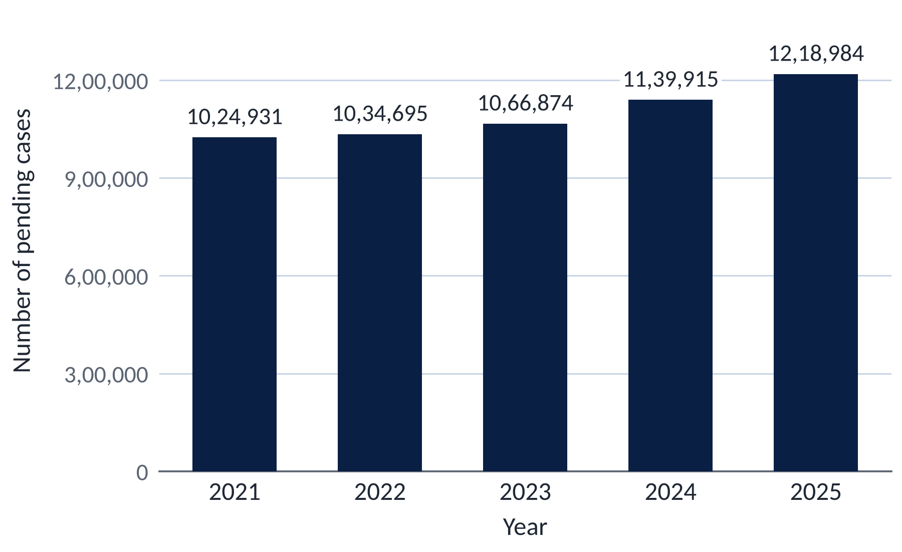

The year-by-year look at case pendency at the Allahabad High Court shows a rise between 2021 and 2025. In 2021 there were 10,24,931 pending cases. By 2025 that number went up to 12,18,984. That is an increase of about 18.93%.

The growth was slow at first: 0.95% in 2022. Then it picked up. In 2023 the increase was 3.11%. In 2024 it jumped to 6.84%. In 2025 it reached 6.94%.

These numbers show the court system is under pressure. There is a need for better case management, more judges and court staff, better technology, faster investigations and changes in how cases are handled. All of this is needed to cut down on the number of pending cases and get cases resolved quickly.

### Bombay High Court

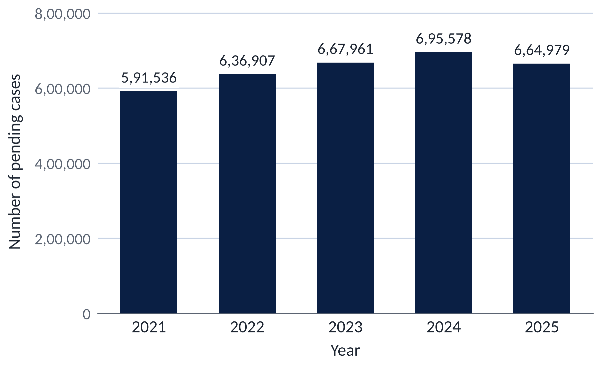

The year-by-year study of case pendency in the Bombay High Court shows a rise from 2021 to 2024 and then a drop in 2025. Pendency grew from 5,91,536 cases in 2021 to 6,95,578 cases in 2024, with the largest yearly jump of 7.67% seen in 2022. The pace of growth slowed in 2023 and 2024. The year 2025 saw a 4.40% fall in pendency. After this recent cut, pendency in 2025 stayed 12.41% above the 2021 figure. This drop might point to court disposal and case-management efforts, yet the still-high volume of pendency shows that ongoing procedural, technological and institutional changes are needed to bring faster justice.

### Calcutta High Court

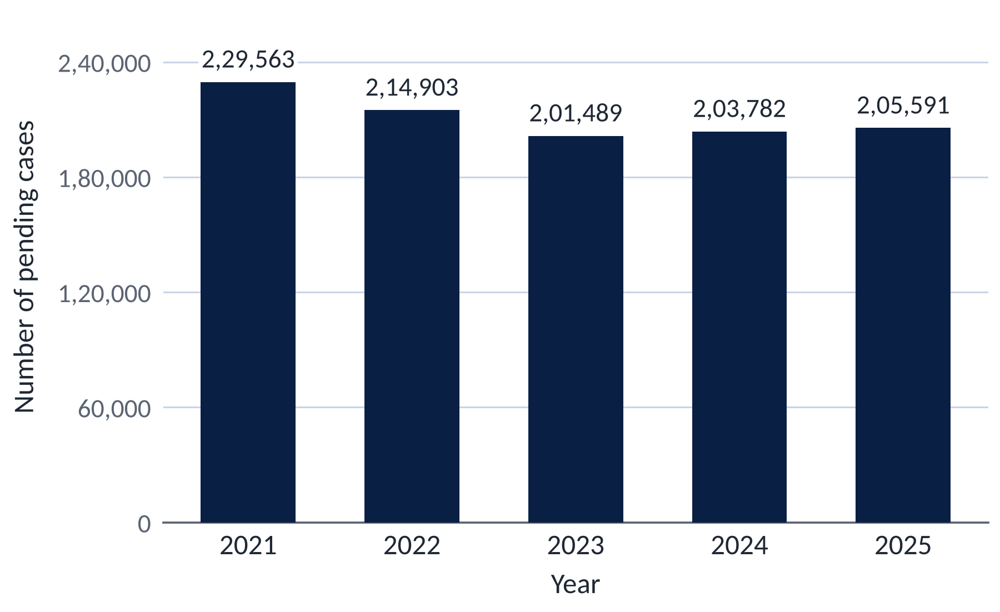

The year-wise analysis of pendency in the Calcutta High Court shows a decline from 2021 to 2025. Pendency dropped by 6.39 percent in 2022 and by another 6.24 percent in 2023, cutting the number of cases from 2,29,563 in 2021 to 2,01,489 in 2023. In 2024 and 2025 the trend turned a little upward, with pendency rising by 1.14 percent in 2024 and by 0.89 percent in 2025. So the total pending cases in 2025 are still about 10.44 percent fewer than in 2021. This overall fall shows that the Calcutta High Court is disposing of cases well and managing its docket effectively. The Calcutta High Court is doing a good job, yet the recent rise in pendency means that the Calcutta High Court must keep working hard to stop new cases from piling up and to keep justice fast.

### Gauhati High Court

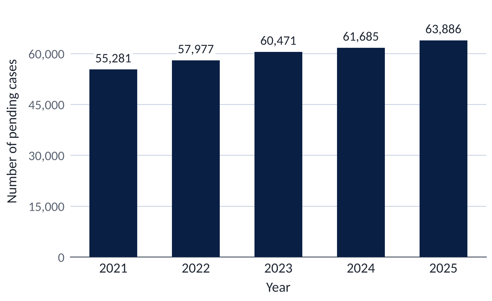

The year-wise analysis of pendency in the Gauhati High Court shows a rise from 2021 to 2025. Pendency grew from 55,281 cases in 2021 to 63,886 cases in 2025, a jump of 15.57 percent. The biggest yearly jump happened in 2022 at 4.88 percent, while the smallest rise was in 2024 at 2.01 percent. Even though the growth slowed in 2024, pendency went up again by 3.57 percent in 2025. This steady increase in pendency keeps the court busy and shows that we need better case management, more judges, technology and changes to procedures so that cases can finish faster.

### High Court for the State of Telangana

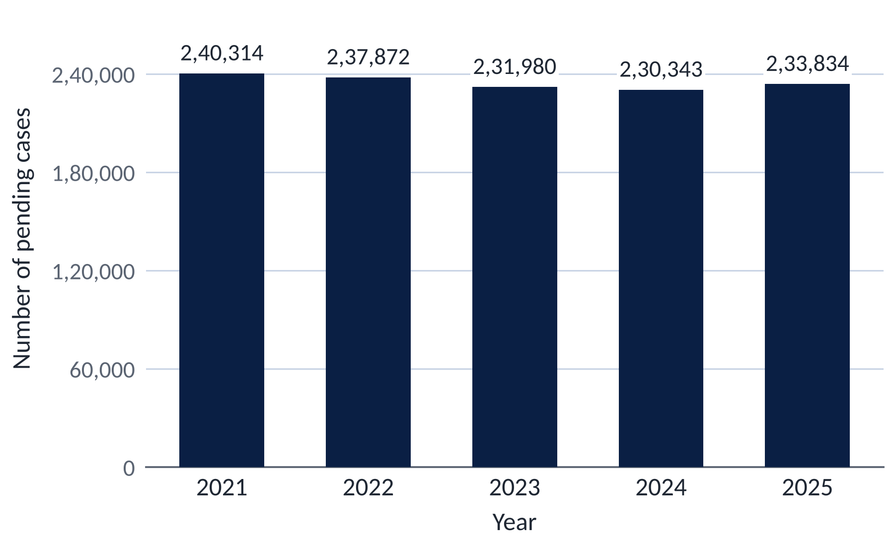

The data shows that the number of cases waiting to be handled went down for the first four years. In each of those years the number dropped: by 1.02%, then 2.48% and then 0.71%. The number of cases was the smallest in the fourth year. It was 2,30,343 cases. In the fifth year the number went up by 1.52%. It went to 2,33,834 cases. Even though there was an increase in the fifth year, the total over five years still shows that the number of cases waiting to be handled went down by 2.70%.

### High Court of Andhra Pradesh

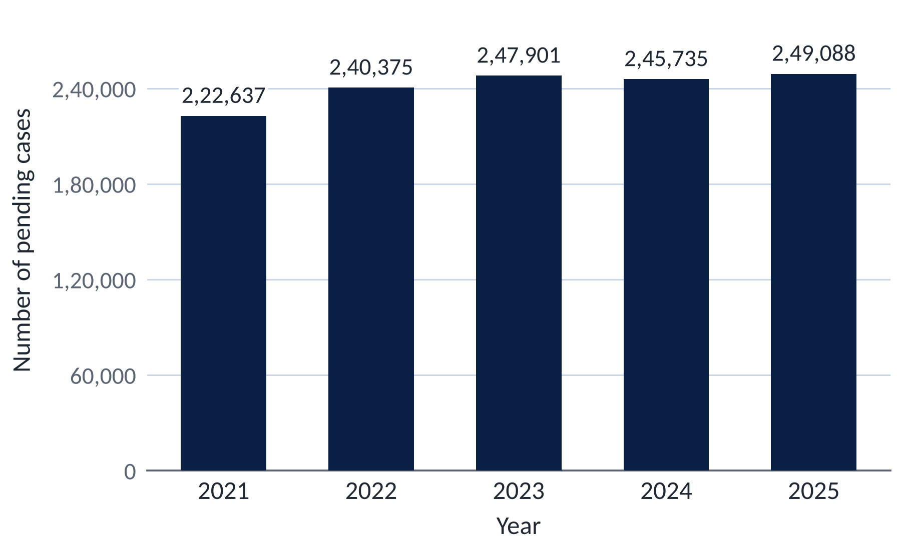

The data shows that case pendency in the High Court of Andhra Pradesh grew a lot during the first three years.

The biggest jump happened from Year 1 to Year 2, with a rise of 7.97%. This means that pendency grew a lot.

In Year 3 pendency rose again, this time by 3.13%, bringing the total to 2,47,901 cases.

Year 4 saw an improvement; pendency dropped by 0.87%, falling to 2,45,735 cases.

That drop did not last. In Year 5 pendency climbed again by 1.36%, reaching the highest level of the five years, 2,49,088 cases.

### High Court of Delhi

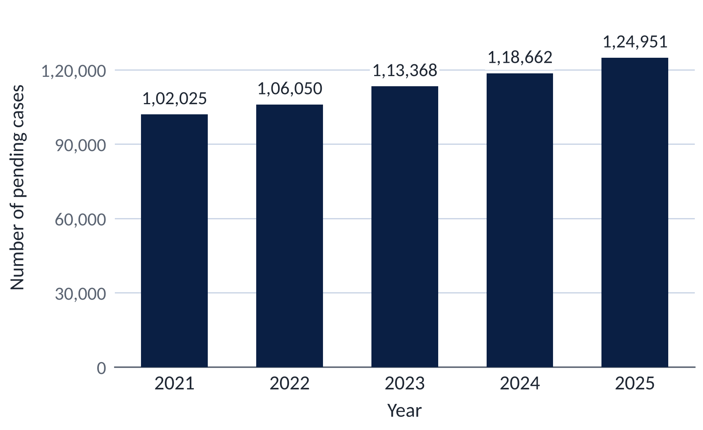

This data shows that pendency keeps growing each year of the study period. Pendency grew by 3.94 percent in the second year and then grew even more, by 6.90 percent, in the third year. The growth slowed to 4.67 percent in the fourth year, but pendency grew again by 5.30 percent in the fifth year.

It is especially important that no year shows a decline. The pending caseload rose from 1.02 lakh to about 1.25 lakh cases, an increase of almost 22.5 percent. This shows that the rate at which cases accumulate is higher than the rate at which cases are being disposed of during the period.

### High Court of Gujarat

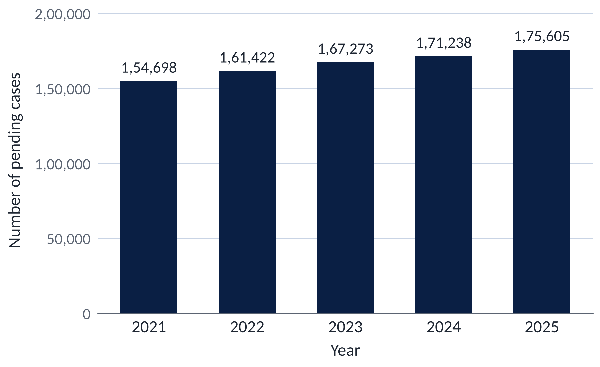

The data shows a rise in pendency. The biggest jump happened from Year 1 to Year 2, when pendency grew by 4.35%. After that the growth rate fell to 3.63% in Year 3 and 2.37% in Year 4. In Year 5 the growth rate went up a bit to 2.55%.

There was no year in the five-year span where pendency fell. Even though the growth rate slowed after Year 2, the total number of pending cases kept growing each year.

The High Court of Gujarat saw a rise of 20,907 pending cases, a 13.52% increase over five years. This steady rise means that case disposal has not kept up with existing litigation.

### High Court of Himachal Pradesh

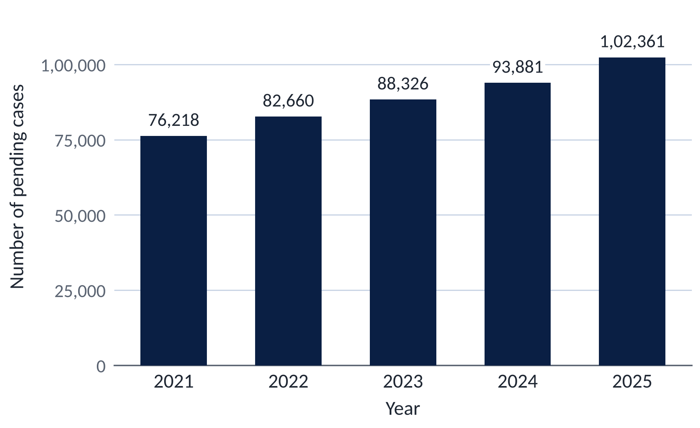

The High Court of Himachal Pradesh shows a rise in case pendency over a five-year span. Pending cases grew from 76,218 in the first year to 1,02,361 in the fifth year, an absolute increase of 26,143 cases, which equals a total rise of 34.30 percent. Year by year, pendency grew by 8.45 percent, 6.85 percent, 6.29 percent and 9.03 percent. The largest yearly rise happened in the fifth year at 9.03 percent. No year shows a drop, which means cases keep piling up. This pattern underlines the need for greater judicial capacity, better case-management systems, faster disposal, more digital tools and alternative dispute-resolution methods to speed up judgments.

### High Court of Jammu and Kashmir

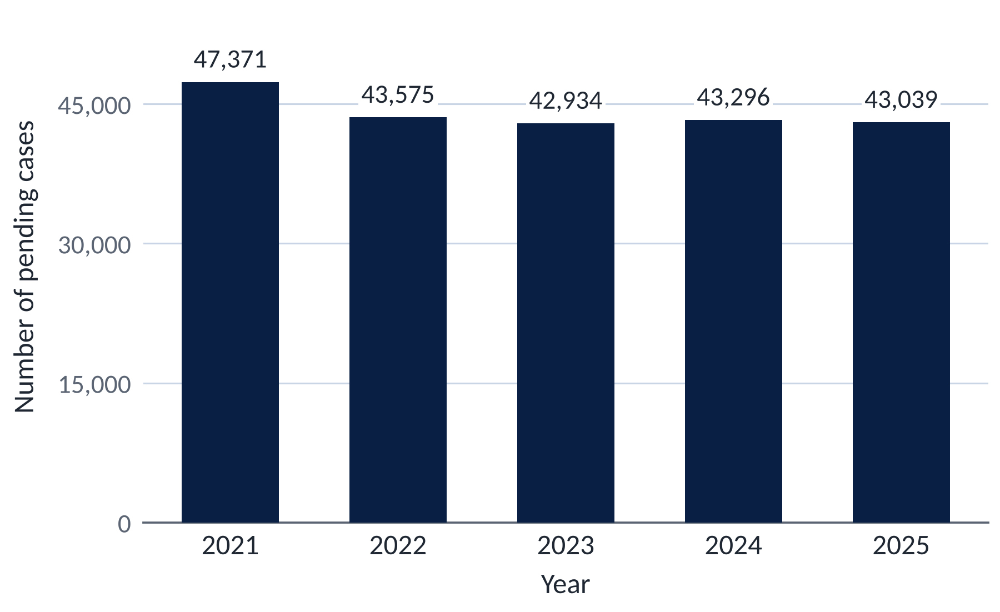

The data shows a reduction of 9.14% in case pendency over the five-year period. The biggest drop happened between Year 1 and Year 2, when pendency decreased by 8.01%. In Year 3 there was a drop of 1.47%. In Year 4 pendency went up slightly by 0.84%, which means there was a short-term reversal. Then in Year 5 pendency fell again, this time by 0.59%.

Overall, the High Court of Jammu and Kashmir shows a trend of case pendency going down over time. Even though there were ups and downs each year, the long-term direction is clearly downward.

### High Court of Chhattisgarh

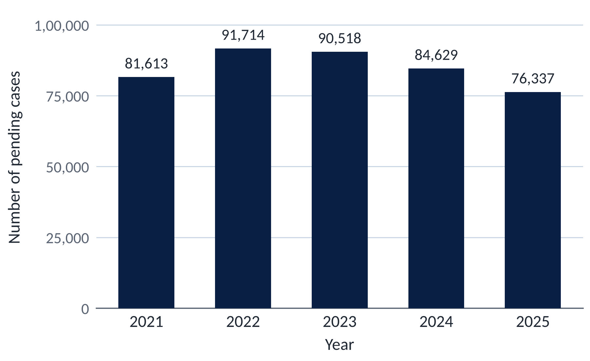

The High Court of Chhattisgarh saw a drop of 5,276 pending cases, which is a 6.46% decrease over five years. In the second year the number of pending cases went up sharply by 12.38%. After that the trend reversed. The next three years showed declines of 1.30%, 6.50% and 9.80% respectively. This shows that the High Court of Chhattisgarh is making progress in clearing cases. The data suggests that the court is moving in the right direction. It also highlights the importance of keeping up with good case management. Timely disposal of cases is key. Digital judicial tools can help speed things up. Alternative dispute-resolution methods should also be used more. These steps together can help achieve justice.

### High Court of Jharkhand

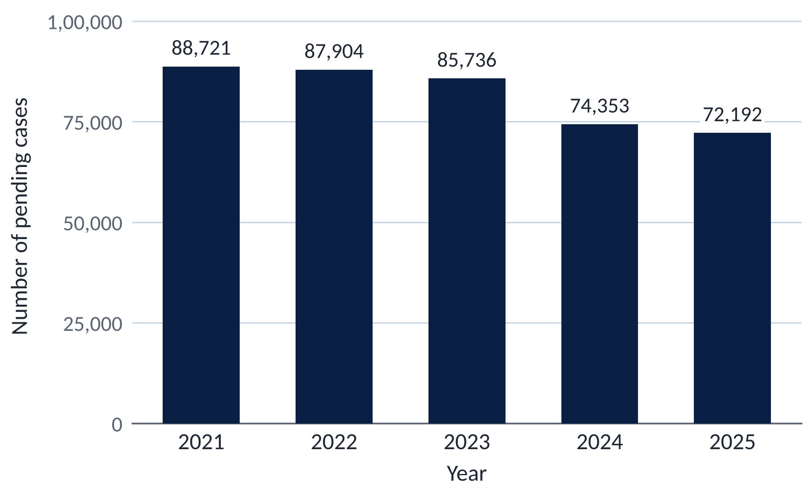

The data shows that the High Court of Jharkhand had a drop in case pendency over five years. At first there was a drop of 0.92% in the second year. Then in the third year there was a bigger drop of 2.47%. In the fourth year the drop was much larger, with pending cases going down by 13.27%. This was the largest drop in one year during the whole time period. In the fifth year there was another drop, this time of 2.91%.

In total, the number of pending cases went down by 16,529. That is an 18.63% decrease over five years. While other High Courts had rising numbers, the High Court of Jharkhand had a drop in the number of cases it had to deal with.

### High Court of Karnataka

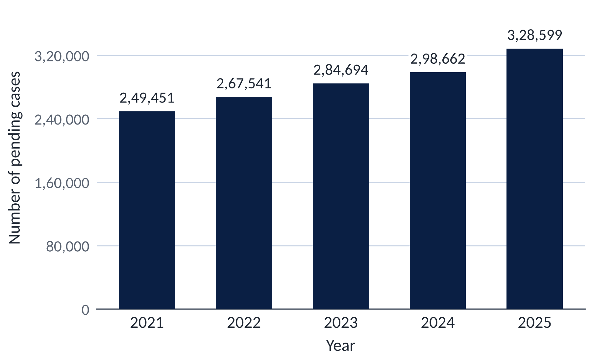

The data shows a rise in the number of pending cases before the High Court of Karnataka. In the second year the pendency went up by 7.25%. The increase continued in the third year with a rise of 6.41%. Although the growth slowed a bit in the fourth year to 4.91%, the final year saw a sharp jump, with pendency increasing by 10.02%.

What stands out most in the data is that there was no year when pendency decreased. The number of pending cases grew from around 2.49 lakh cases to 3.29 lakh cases. This means the total increase is 31.73%. This big jump shows that the court has not been able to clear cases fast enough. The number of cases has kept building up faster than they can be resolved.

### High Court of Kerala

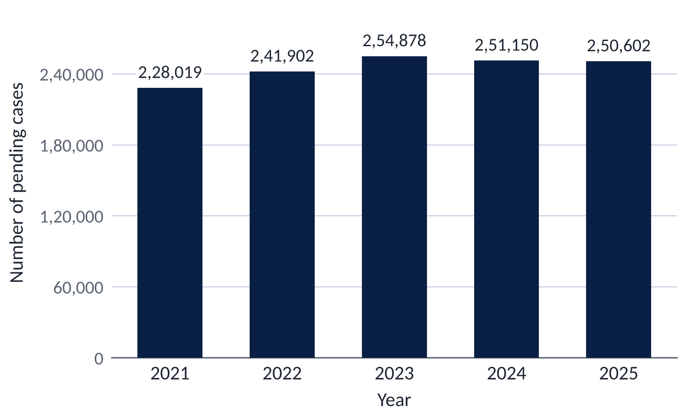

The data shows that case pendency in the High Court of Kerala went up a lot at first. Pendency went up by 6.09% in the second year and then by another 5.36% in the third year. This made the number of cases reach a high of 2,54,878. This means that a lot of cases built up during the first part of the study period.

The pattern changed in the fourth year, when pendency went down by 1.46%. In the fifth year it went down a little more, by 0.22%. These drops show that there was some progress in managing the backlog. The drops were not enough to cancel out the big increases that happened in the first three years. So over the five years there was still a 9.90% rise in pending cases. The data shows a mix of changes, but more cases are pending. The recent small improvements need support from the institutions to keep going.

### High Court of Madhya Pradesh

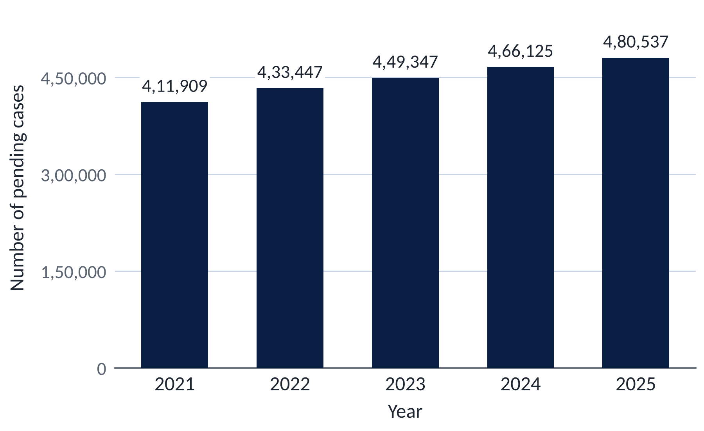

The data shows that the number of cases waiting to be heard at the High Court of Madhya Pradesh kept going up during the five-year period. In the second year the number of pending cases went up by 5.23%. Then in the following years it went up by 3.67%, 3.73% and 3.09% respectively. Even though the amount of increase got smaller after the second year, the total number of cases that were still pending went up every single year.

There was no year where the number of pending cases went down. The number of cases that were not yet decided went from about 4.12 lakh to 4.81 lakh. This means there was an increase of 68,628 cases, or 16.66%. This shows that the rate at which cases were being resolved was not enough to stop the growing number of cases that were still waiting.

### High Court of Manipur

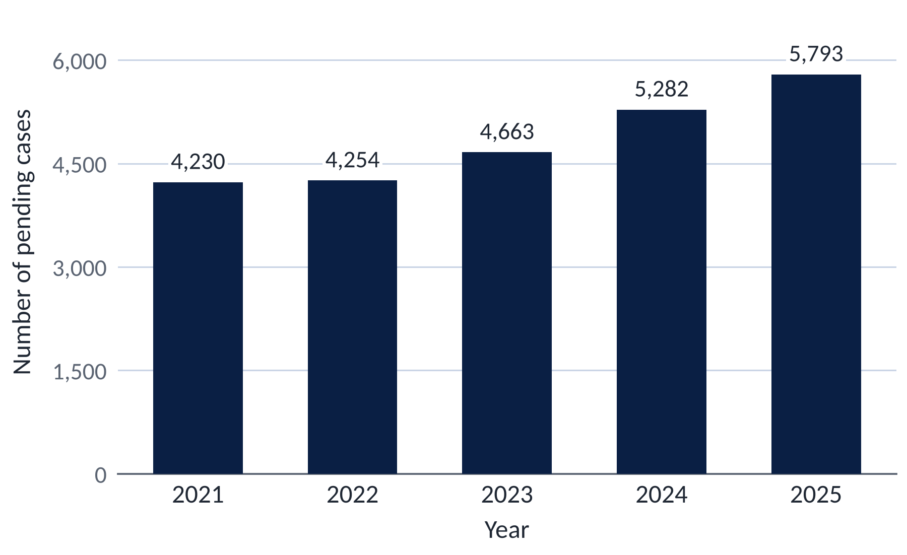

The data shows that there was a rise in the number of cases that were not resolved in the High Court of Manipur over five years. In the second year the rise was small, at 0.57%, but then it grew a lot after that. In the third year the number of cases that were still pending went up by 9.62%. In the fourth year the highest increase happened, at 13.27%. In the fifth year the number of pending cases went up again by 9.67%.

No year had a drop in the number of pending cases. The total number of cases that were still pending went up by 1,563 cases, which is a big increase of 36.95% overall. The fast growth shows that more and more cases are piling up. This creates worries about whether the court system can handle and settle cases fast enough to avoid a big backlog.

### High Court of Meghalaya

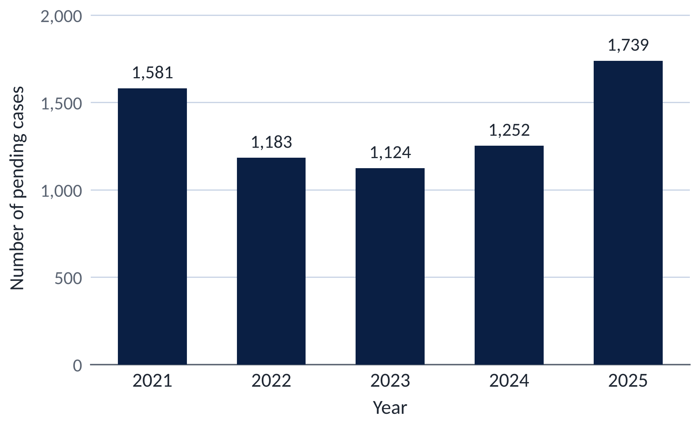

The High Court of Meghalaya shows a variable pattern of case pendency over a five-year period. Pendency fell sharply by 25.17 percent, dropping from 1,581 cases to 1,183 cases in the second year. A further drop of 4.99 percent happened in the third year, when pendency hit its lowest point at 1,124 cases.

The falling trend later turned around. Pendency rose by 11.39 percent in the fourth year and jumped sharply by 38.90 percent in the fifth year, reaching 1,739 cases, the highest number seen in the period. The rise in the final year is especially important because it more than made up for the earlier drops.

In total, pendency grew by 158 cases, which is a net increase of 9.99 percent over five years. The data shows that although big reductions were made at first, they did not last.

### High Court of Punjab and Haryana

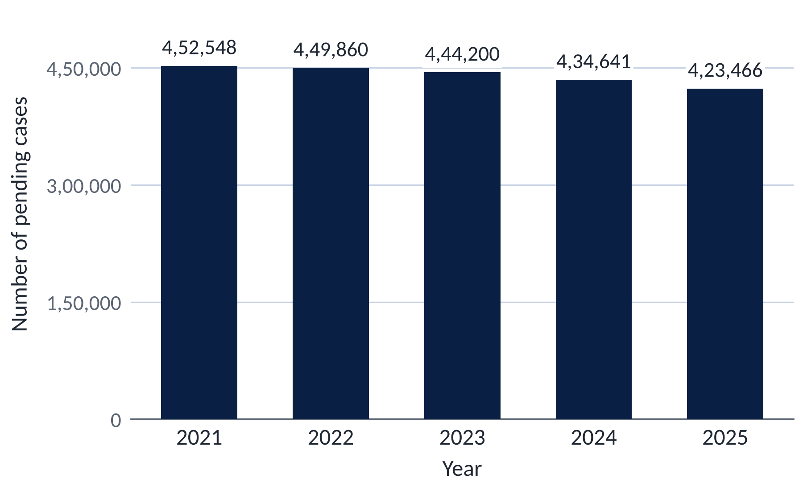

The High Court of Punjab and Haryana shows an uneven pattern of case backlog over five years. Backlog dropped each year: in the second year it fell by 0.59%, in the third by 1.26%, in the fourth by 2.15% and in the fifth by 2.57%. The fact that backlog never increased is important. The number of pending cases went from 4,52,548 to 4,23,466, a drop of 29,082 cases or 6.43%. The larger yearly drops in later years show that the court is getting better at handling and closing cases.

### High Court of Rajasthan

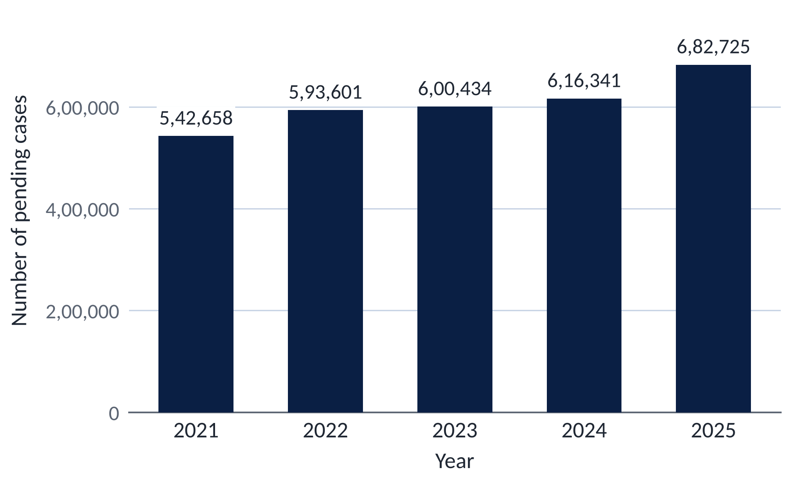

The data shows that the number of cases kept growing before the High Court of Rajasthan. The biggest jump happened between Year 1 and Year 2, when the cases increased by 9.39%. Then there was a rise of 1.15% in Year 3. The number of cases went up by 2.65% in Year 4. The last year had a rise of 10.77%, making the total number of cases 6,82,725. That was the highest number during the whole study period.

Importantly, there was no year where the number of cases went down. The total number of cases went up by 1,40,067, which is 25.82%. That is an increase in the number of cases that are still waiting to be handled. The big rise in the final year stands out and shows that getting rid of the old cases is still a big problem for the court system.

### High Court of Sikkim

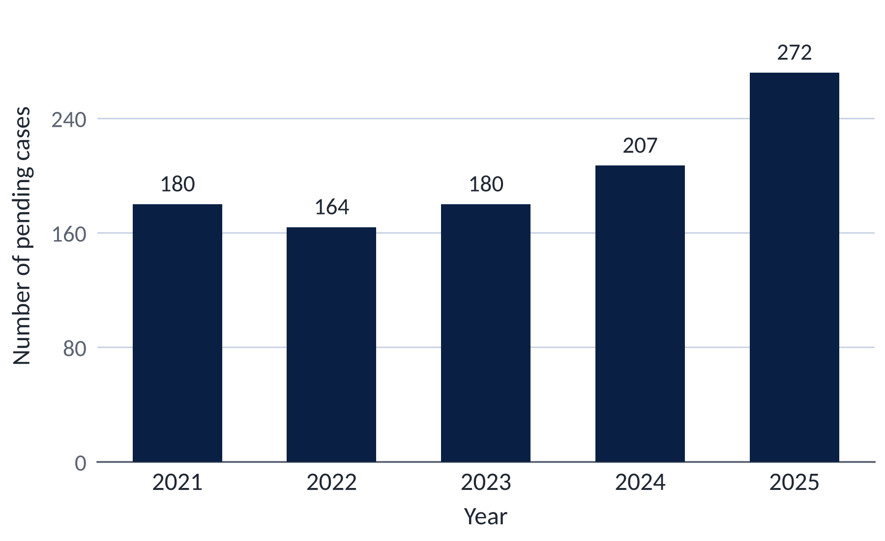

The data shows a changing pattern of case pendency in the High Court of Sikkim. In the second year pendency fell by 8.89%, dropping from 180 to 164 cases. That drop was brief, because pendency rose back to 180 cases in the third year, a 9.76% increase. After that the upward trend grew stronger. Pendency went up by 15.00% in the fourth year and by a large 31.40% in the fifth year, reaching 272 cases, the highest level seen in the study period. Even though the total number of cases is not very large, the 51.11% overall rise is big in percentage terms. The data shows that the High Court had a large proportional growth in its pending caseload.

### High Court of Tripura

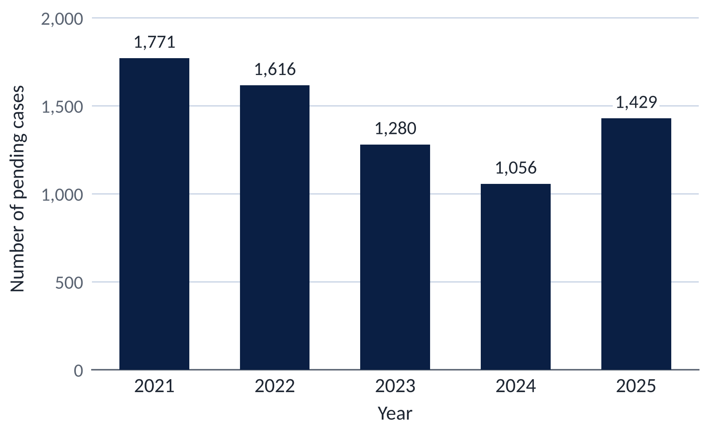

The High Court of Tripura demonstrates a strong declining trend during the first four years of the study period. Pendency decreased by 8.75% in the second year, followed by a significant reduction of 20.79% in the third year and a further 17.50% decline in the fourth year. Consequently, pending cases reached their lowest level of 1,056 cases in the fourth year.

However, the fifth year witnessed a substantial reversal, with pendency increasing by 35.32%, rising to 1,429 cases. Despite this sharp final-year increase, the overall quinquennial position remains favourable, with pendency declining by 342 cases, equivalent to 19.31%.

### High Court of Uttarakhand

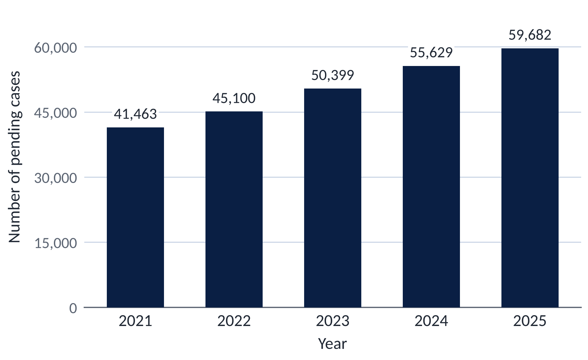

The data shows a year-to-year rise in case pendency in the High Court of Uttarakhand. Pendency grew by 8.77 percent in the second year, then jumped to 11.75 percent in the third year. The upward trend kept going, with a 10.38 percent rise in the fourth year and a 7.28 percent rise in the fifth year. Although the yearly growth rate fell in the later years, the total number of pending cases still went up. Importantly, no year saw a drop in pendency. Across the five-year stretch, pending cases rose by 18,219 cases, a big 43.94 percent overall increase.

### Madras High Court

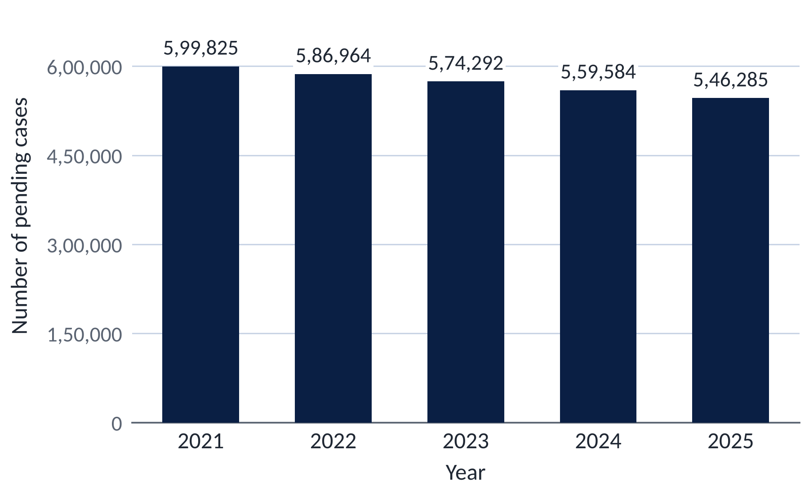

The data shows a year-on-year drop in case pendency before the Madras High Court. Pendency fell by 2.14% in 2022, then fell again by 2.16% in 2023. The fall grew to 2.56% in 2024 before easing to 2.38% in 2025. Importantly, each year saw a drop, with no year showing a rise. Over the five-year span, pending cases were reduced by 53,540 cases, a drop of 8.93%. This steady decline shows an effort to keep the judicial backlog under control. The fall is especially important because the Madras High Court started this period with nearly six lakh pending cases.

### Orissa High Court

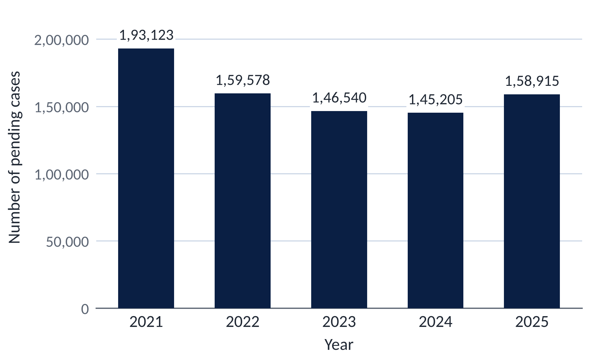

The data shows a drop in pendency during the first four years. The biggest drop in pendency happened in 2022, when pendency fell by 17.37%, from 1,93,123 to 1,59,578. Another drop of 8.17% in pendency happened in 2023, followed by a drop of 0.91% in 2024. Consequently, pendency reached a low point of 1,45,205 cases in 2024.

The good trend turned back in 2025, when pendency rose by 9.44%, reaching 1,58,915 cases. Even though pendency rose in 2025, the overall five-year picture stayed good because pendency fell by 34,208 cases, which is 17.71%. The Orissa High Court shows progress in cutting accumulated cases, especially in 2022 and 2023. The increase in 2025 shows that the drop in pendency was not sustained.

### Patna High Court

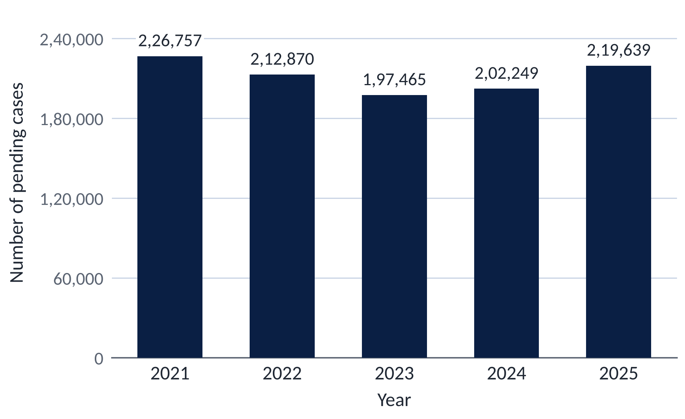

The case backlog data for the Patna High Court shows a mixed pattern. In the first two years there was a big drop in the number of cases waiting to be decided. The backlog went down by 6.13% in 2022, then by another 7.24% in 2023, when it reached the smallest number of cases recorded in the study period, 1,97,465.

This downward trend stopped in 2024, when the number of cases went up by 2.42%. Then in 2025 there was a jump of 8.60%. At the end of the period studied, the number of cases was 2,19,639. Even though there was an increase in the last two years, the overall situation over five years still shows a 3.14% decrease compared to 2021.

### All High Courts

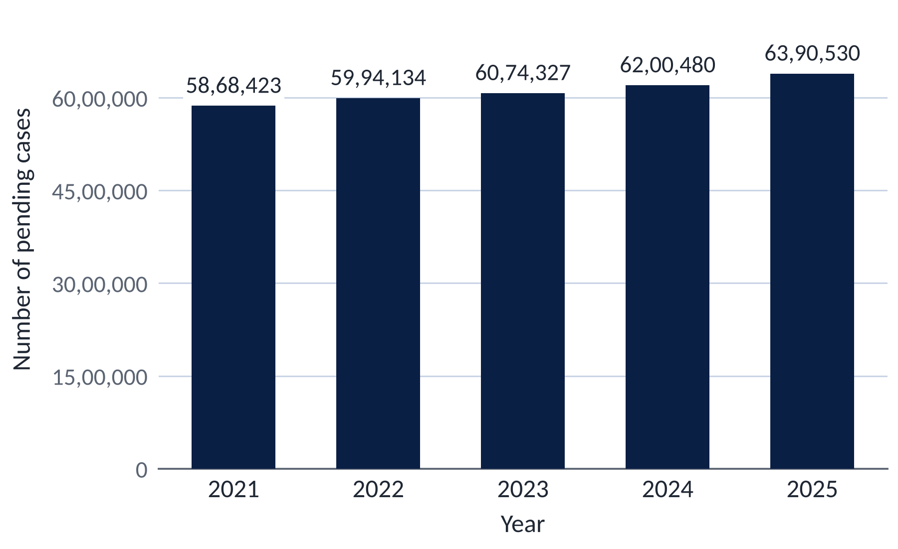

The aggregate data shows a steady rise in pendency across all Indian High Courts. The total number of pending cases grew each year, with no year showing a decline over the five-year period. Pendency grew by 2.14% in 2022, then by 1.34% in 2023. Pendency grew again, by 2.08%, in 2024 and by 3.07% in 2025, the highest yearly increase in the study.

Overall, pendency rose by 5,22,107 cases, which is an 8.90% increase over five years. The sharp rise in 2025 is especially important because it shows that the total judicial workload keeps growing despite many reforms and new technology.

## Results

The five-year data above gives a factual basis for checking the state of pendency in Indian High Courts and its effect on quick, fair and effective trials. Pendency grew from 58,68,423 cases in 2021 to 63,90,530 cases in 2025. So during the study period the total backlog grew by 5,22,107 cases, about an 8.90% rise.

The aggregate figures show that pendency grew each year. Even though the growth rate slowed to 1.34% in 2023, pendency then picked up again, to 2.08% in 2024 and 3.07% in 2025. This shows that the problem of growing litigation stays strong.

### High Courts with the highest pendency

The data reveals considerable variation among High Courts. In 2025, the largest pending caseloads were recorded by:

1. Allahabad High Court – 12,18,984
2. Rajasthan High Court – 6,82,725
3. Bombay High Court – 6,64,979
4. Madras High Court – 5,46,285
5. Madhya Pradesh High Court – 4,80,537
6. Punjab and Haryana High Court – 4,23,466
7. Karnataka High Court – 3,28,599

These figures show that the burden of pendency is not spread evenly across the High Court system. The Allahabad High Court alone jumped from 10,24,931 cases in 2021 to 12,18,984 in 2025, a rise of 18.93 percent. The Rajasthan High Court increased by about 25.82 percent and the Karnataka High Court increased by 31.73 percent. The burden of pendency is clear in each of these courts.

### High Courts showing reduction in pendency

The empirical data also demonstrates that some High Courts succeeded in reducing their accumulated caseload.

Particularly notable reductions between 2021 and 2025 include:

- Tripura: −19.31%
- Jharkhand: −18.63%
- Orissa: −17.71%
- Jammu & Kashmir: −9.14%
- Madras: −8.93%
- Chhattisgarh: −6.46%
- Punjab and Haryana: −6.43%
- Telangana: approximately −2.70%

These results are important because they demonstrate that reduction of pendency is achievable through effective institutional and case-management practices. However, the aggregate national position remains adverse because increases in several high-volume High Courts outweigh reductions elsewhere.

### Implications for speedy and fair trial

The empirical results have implications for the constitutional principle of speedy justice under Article 21. A backlog that keeps growing can lead to litigation, create more uncertainty for litigants, delay remedies for victims and add more burdens on accused persons in criminal proceedings.

At the same time, speedy adjudication cannot be the same as disposing of cases at any cost. An effective judicial system must achieve both speed and fairness, due process and quality of adjudication. Speedy adjudication is essential. Fairness must not be sacrificed.

The goal should be expedited adjudication, not just quick disposal of cases. Excessive pressure to dispose of cases quickly can threaten fairness if it limits hearing, legal representation, evidence examination or thoughtful decision-making.

### Final research result

The five-year empirical analysis of case pendency in High Courts shows that the judicial backlog has kept growing from 2021 to 2025. Total pendency rose from 58,68,423 cases to 63,90,530 cases, an increase of 5,22,107 cases and a growth of 8.90%. While several High Courts, especially Tripura, Jharkhand, Orissa, Jammu & Kashmir and Madras, cut back on cases, these gains were not enough to balance the rises in high-volume areas such as Allahabad, Rajasthan, Bombay, Karnataka and Madhya Pradesh. The data prove that a speedy and fair trial needs more than disposal. It needs institutional reform that grows judicial capacity, improves case management, uses technology, boosts procedural speed and protects due-process rights. The evidence clearly shows that we must take steps to achieve expedited adjudication without losing fairness or the quality of justice.

## Major Findings of the Study

The quinquennial empirical analysis of case pendency in the 25 High Courts of India for the period 2021–2025 reveals significant variations in the judicial workload and disposal trends. The findings are particularly relevant to the objective of ensuring speedy, fair and effective adjudication.

### Overall increase in judicial pendency

The most significant finding is that aggregate pendency increased continuously from 58,68,423 cases in 2021 to 63,90,530 cases in 2025.

- Absolute increase: 5,22,107 cases
- Overall increase: 8.90%
- Annual increase:
    - 2022: 2.14%
    - 2023: 1.34%
    - 2024: 2.08%
    - 2025: 3.07%

The highest annual increase occurred in 2025 (3.07%), indicating that the accumulated judicial burden continued to expand.

### More High Courts experienced an overall increase than a decrease

On comparing 2021 and 2025, 15 of the 25 High Courts recorded an overall increase in pendency, while 10 High Courts recorded an overall reduction.

This demonstrates that although certain jurisdictions have succeeded in controlling their backlog, the broader High Court system continues to face substantial pendency.

### Allahabad High Court has the highest pendency

The Allahabad High Court has recorded the highest pending caseload among all High Courts in the dataset over the period studied, and this shows a real challenge.

Its pendency grew from 10,24,931 cases in 2021 to 12,18,984 cases in 2025, a jump.

That is an increase of 18.93 percent, which is a lot.

This large caseload has implications for how quickly cases are decided and shows that we need better case-management strategies for courts that handle a lot of cases.

### Rajasthan also witnessed growth

The Rajasthan High Court recorded an increase from 5,42,658 cases in 2021 to 6,82,725 cases in 2025, representing an overall increase of 1,40,067 cases or 25.82 percent, and the numbers are climbing fast.

The sharp increase in the final year indicates the need for stronger mechanisms to prevent further accumulation, so we must act.

### Karnataka and Madhya Pradesh show growth

The Karnataka High Court increased from 2,49,451 to 3,28,599 cases, representing a 31.73 percent increase, and this is a clear signal that capacity is being stretched.

Similarly, the Madhya Pradesh High Court increased from 4,11,909 to 4,80,537 cases, representing a 16.66 percent increase. We must watch this trend closely.

Both the Karnataka High Court and the Madhya Pradesh High Court demonstrate that persistent growth in institution and/or insufficient disposal capacity can result in long-term accumulation, and this is a warning.

### Some High Courts demonstrated successful reduction

The data also provides positive evidence. Several High Courts reduced their pending cases between 2021 and 2025 (Table 1):

Table: Table 1. High Courts that reduced their pending cases between 2021 and 2025

| High Court | Overall Change |
|:---|---:|
| Tripura | −19.31% |
| Jharkhand | −18.63% |
| Orissa | −17.71% |
| Jammu & Kashmir | −9.14% |
| Madras | −8.93% |
| Chhattisgarh | −6.46% |
| Punjab & Haryana | −6.43% |
| Telangana | −2.70% |
| Patna | −3.14% |

These results establish that reduction of judicial backlog is achievable when appropriate disposal and case-management mechanisms are effectively implemented.

### Madras High Court demonstrates sustained improvement

The Madras High Court shows a positive trend. Pendency fell steadily from 5,99,825 in 2021 to 5,46,285 in 2025, showing an 8.93 percent reduction.

The lack of a rise in cases for the Madras High Court shows that the backlog is being reduced in a steady way.

### Orissa and Tripura show fluctuating improvement

The Orissa High Court cut pendency by 17.71 percent overall and Tripura saw a 19.31 percent reduction.

Both saw case numbers rise again in the final year. This shows that a short-term cut is not enough; we need case-management methods.

### Smaller High Courts show large percentage variations

High Courts such as Sikkim and Manipur show relatively small absolute numbers but considerable percentage changes.

For example, Sikkim increased from 180 to 272 cases, representing 51.11% growth. Although this percentage is high, the absolute increase is only 92 cases.

Therefore, percentage change should always be interpreted alongside absolute pendency.

### Pendency has direct implications for speedy and fair justice

The persistent increase in pending cases creates challenges for the constitutional objective of speedy justice under Article 21. Delay may affect:

- the timely resolution of disputes;
- victims seeking remedies;
- accused persons awaiting trial;
- availability and reliability of evidence;
- witness participation;
- legal costs; and
- public confidence in the system.

However, quick handling of cases must not hurt fairness. The goal should be to handle cases while still following the right steps, instead of just getting rid of the case by ignoring the rules that protect people's rights.

## Conclusion

The five-year study shows that judicial pendency is still one of the challenges facing the Indian High Court system.

The total number of pending cases rose from 58,68,423 in 2021 to 63,90,530 in 2025, a rise of 8.90%.

The findings show a mixed picture. Fifteen High Courts saw a rise in pending cases, while ten High Courts managed to lower their pendency. This variation shows that judicial backlog is not the same across India and that factors such as institutional capacity, case-flow management, judicial strength, procedural practices and local workload patterns can affect pendency.

The evidence also shows that reducing pendency is possible. The good results from Jharkhand, Tripura, Orissa, Madras, Jammu & Kashmir, Punjab and Haryana and other High Courts give examples for creating better case-management policies.

At the same time, the continuing rise in total pendency shows that current measures are still not enough to reverse the national trend. The growing backlog threatens the delivery of timely justice and may weaken the idea that justice should be fair and also given in a reasonable time.

Therefore, the main conclusion of this study is that India needs a model of quick adjudication that mixes speed, fairness, judicial independence, due process and quality of decisions. Quick disposal by itself is not enough for reform if it hurts the rights of litigants.

## Suggestions

### Increase judicial strength

Vacancies in High Courts should be filled quickly. Having enough judges compared to the number of cases is important to stop new cases from piling up.

### Strengthen case-flow management

High Courts should use ways to manage their dockets and the flow of cases, including grouping cases by how old they are, how urgent they are, how complex they are and what kind of disagreement they involve.

### Old and vulnerable cases

Cases that have been waiting for a long time should be given special attention. Special groups of judges or special lists can be made for cases that have been delayed for a long time, for older people involved in legal issues, for people who are in jail without a trial and for other people who need help.

### Reduce unnecessary adjournments

Unnecessary and repeated delays in court should be reduced by following the rules carefully. There should still be fair chances for people to share their side of the story.

### Strengthen courts

More use of digital filing, electronic records of cases, online court hearings, sending notices through electronic means and managing evidence digitally should be encouraged, while keeping security, privacy and proper rules in place.

### Promote alternative dispute resolution

Mediation, arbitration, conciliation, Lok Adalats and other ways to settle disputes without going to court should be made stronger for cases that can be settled. This can help reduce the work of courts and let judges focus on cases that need a real decision.

### Establish case-management mechanisms

High Courts that handle a lot of cases, like Allahabad, Rajasthan, Bombay, Madras and Madhya Pradesh, can use special ways to manage their cases based on the type of cases they get and how many they have.

### Improve court infrastructure

Judicial reform needs courtrooms, trained staff, people who take notes, researchers, technology and support from forensic experts when needed.

### Strengthen data-based judicial administration

Pendency should be monitored through indicators such as:

- institution rate;
- disposal rate;
- clearance rate;
- age-wise pendency;
- average duration of cases;
- judge-wise workload; and
- category-wise pendency.

This would give a better picture than raw pendency numbers alone.

### Balance speed with fairness

Any policy designed to reduce pendency must protect:

- the right to be heard;
- legal representation;
- natural justice;
- evidentiary safeguards;
- reasoned judgment; and
- timely disposal.

Thus, fast justice should not mean rushed justice; it should mean justice without losing fairness.

### Develop a framework for expedited adjudication

A coordinated framework involving the Supreme Court, High Courts, government, judiciary and legal-services institutions could set clear targets to cut backlog while keeping judicial independence and case complexity in mind.

### Regular quinquennial empirical assessment

The Government and judiciary should publish clear year-by-year pendency data and carry out periodic studies. These studies can spot good practices and let them be copied in other areas.

## Implications for Judicial Reform

The empirical results suggest the need for a strategy involving:

- timely filling of judicial vacancies;
- strengthening court infrastructure and staff;
- structured case-flow and docket management;
- prioritising old and long-pending cases;
- cutting unnecessary adjournments;
- using more digital case-management systems;
- improving e-Courts and virtual hearings;
- promoting mediation and other ADR mechanisms;
- better coordination between investigation, prosecution and courts in criminal matters; and
- regular monitoring of institution, disposal and pendency rates.

## References

1. *Imtiyaz Ahmad v. State of Uttar Pradesh*, (2012) 2 SCC 688 (India).
2. Law Commission of India. (2014). *Arrears and backlog: Creating additional judicial (wo)manpower* (Report No. 245). Government of India.
3. *Abdul Rehman Antulay v. R.S. Nayak*, (1992) 1 SCC 225; AIR 1992 SC 1701.
4. *P. Ramachandra Rao v. State of Karnataka*, (2002) 4 SCC 578; AIR 2002 SC 1856.
5. *Hussainara Khatoon v. Home Secretary, State of Bihar*, (1980) 1 SCC 81 (India).
6. *Abdul Rehman Antulay v. R.S. Nayak*, (1992) 1 SCC 225 (India).
7. *P. Ramachandra Rao v. State of Karnataka*, (2002) 4 SCC 578 (India).
8. *Vakil Prasad Singh v. State of Bihar*, (2009) 3 SCC 355 (India).
