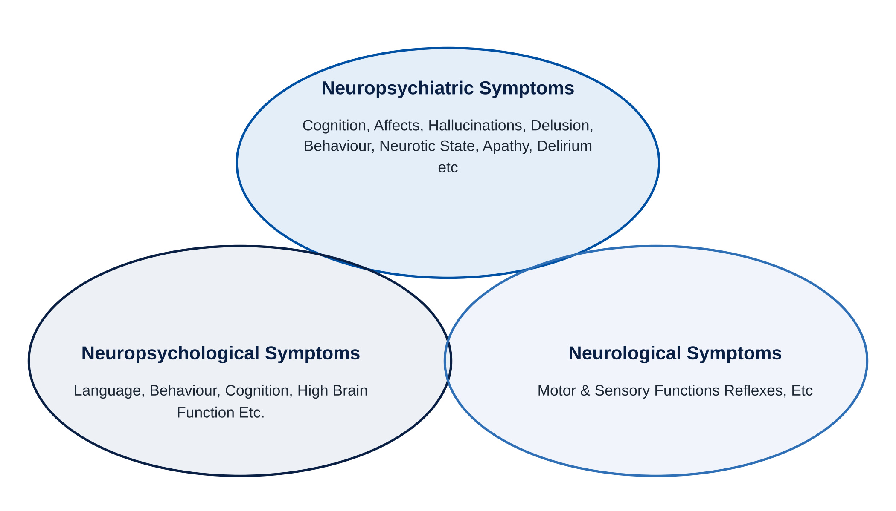

## Introduction

The complexity of neuropsychiatric disorders poses a significant challenge in the realm of contemporary medicine and neuroscience. Psychiatric symptoms are often brought on by neurological problems. It is advised to refer to psychological symptoms or syndromes brought on by organic brain illnesses as "neuropsychiatric symptoms" or "neuropsychiatric syndromes." Neuropsychiatric disorders are the term used to describe cerebral disorders that result in psychiatric symptoms^1^.

Neuropsychiatric disorders are a subset of mental disorders for which there is some knowledge about the underlying brain pathology and, most importantly, this pathology is relevant to treatment. Neuropsychiatric disorders are specific, clinically recognised conditions in which an individual's thoughts, perceptions, emotions, and/or overt behaviour cause suffering and interfere with the individual's daily life. By definition, these illnesses have a significant impact on how a person expresses their personality; they adversely affect comfort and willingness to interact with others, as well as attitudes towards oneself, mood, and disposition. Individual variations have traditionally been understood to reflect variability related to categorical distinctions^2^. It presents a diverse array of difficulties both in clinical practice and research, due to the wide range of symptoms and underlying causes these disorders can exhibit. A thorough grasp of this multifaceted field is crucial for healthcare professionals and researchers to provide effective and comprehensive care to those affected. This entails understanding the different types of neuropsychiatric disorders, their root causes, and the current methods of diagnosis and management. Our discussion delves into these topics by exploring the various classifications of neuropsychiatric disorders, such as neurodegenerative conditions, mood disorders, psychotic disorders, traumatic brain injury, and stroke-related neuropsychiatric disorders. Each subgroup is characterized by distinct clinical presentations, pathophysiologies, and impacts on cognitive, emotional, and behavioral functioning. Additionally, we investigate the intricate interplay of genetic, environmental, neurochemical, and vascular factors that contribute to the development and progression of these disorders. With advancements in diagnostic techniques like neuropsychological assessments, neuroimaging, genetic testing, and biomarker analysis, the ability to accurately identify and classify these conditions has improved significantly. Furthermore, this article examines various treatment and management strategies, including pharmacological interventions, psychological therapies, neuromodulation techniques, and lifestyle modifications. By synthesizing the current knowledge of this complex field, our review aims to inform and guide healthcare professionals, researchers, and policymakers in their efforts to enhance the quality of life and outcomes for those affected by the vast spectrum of neuropsychiatric disorders^3,4^.

## Literature Review

The study of neuropsychiatric disorders has changed a lot because of progress in neuroscience, psychiatry, pharmacology and clinical psychology. The existing information shows that these disorders happen because of interactions between genetic tendencies, brain problems, outside influences and social and psychological factors. The information that has been reviewed gives a base for understanding how to classify, diagnose, treat and manage these disorders over time.

Miyoshi, Morimura and Maeda (2010), in *Neuropsychiatric Disorders*, talked about the link between brain problems and mental symptoms. Their work gives an idea for understanding how changes in the brain's structure and functions can lead to problems with thinking, feeling and acting.

Berton and Nestler (2006) looked at new ways to create antidepressant drugs beyond the usual ideas about chemicals in the brain. Their work shows how important it is to look at brain processes and create better medicines for mood problems. Also, Drevets (2000) studied brain scans linked to mood disorders, showing how looking at brain structure and function can help understand health issues.

Studies about neurodegenerative diseases have also added a lot to the field. The Alzheimer's Association (2021) wrote about the impact of Alzheimer's disease on thinking, social life and health care. Research on Parkinson's disease and Huntington's disease also shows how the slow loss of brain cells can cause both brain symptoms and mental problems.

Merikangas et al. (2011) studied how common bipolar disorders are and what factors are connected to them. Kessler et al. (2005) looked at how common mental disorders are and when they usually start. These studies show how common mental health problems are and how important it is to find them early, diagnose them properly and start treatment quickly.

Lewis and Lieberman (2000) studied the way schizophrenia develops and what is happening in the brain. They pointed out the need to understand the underlying biology of this disorder. Karlsgodt et al. (2008) studied how changes in brain connections are linked to schizophrenia, supporting the idea of looking at brain networks instead of just focusing on single chemicals.

Geschwind and Flint (2015) looked at how genes and genetic research help in understanding disorders. Their work shows that genetic risks work with growing-up influences, not just by themselves, to create most mental health problems.

Najjar et al. (2013) studied how brain inflammation and mental illness are connected. Gorelick (2019) talked about inflammation and thinking problems. This information suggests that some brain inflammation might help cause mental health issues, but the exact role is different for each condition and needs more study.

Lezak et al. (2012) wrote an account about how to check brain function, making clear how important it is to test memory, focus, language and thinking skills. Research on behavior therapy by Hofmann et al. (2012) also shows how helpful evidence-based therapy is for many mental health problems.

Cramer et al. (2011) looked at the chance to use brain changes for treatment. This work helps explain how people can recover after brain injuries. Studies on care that includes areas of health also show how important it is to use medical, mental, recovery and social help together.

Overall, the current information offers a lot of knowledge about the body processes, signs, how to diagnose and how to treat disorders. However, the large number of these disorders and the unclear reasons behind them show that a full team-based look is needed.

## Research Methodology

### Research design

This study uses an analytical narrative review to look at neuropsychiatric disorders. It pulls together existing work on how neuropsychiatric disorders show up in patients, what causes them, how to test for them, how to treat them and what problems arise in care.

The study does not collect data, run experiments, talk to patients or run a fresh survey.

### Sources of data

The research draws on sources, including:

- Peer-reviewed research articles and review papers.
- Standard textbooks on neuroscience, psychiatry, pharmacology and neuropsychology.
- Clinical and diagnostic publications.
- Publications by known health groups.
- Relevant science books on disorders, psychiatric conditions, brain scans, biomarkers and treatment methods.

Databases such as PubMed, PubMed Central, Google Scholar and other medical journal sites can be used to find papers.

### Selection of literature

A paper is relevant if it talks about one or more of these themes: neurodegenerative diseases, mood disorders, anxiety disorders, psychotic disorders, brain injury, stroke-related neuropsychiatric conditions, genetic and environmental risk factors, tests for diagnosis and ways to treat.

Peer-reviewed work, well-known scientific books and recent evidence-based guides get priority. Older foundational works are also kept when they give theory or history.

### Method of analysis

The chosen papers are read for themes. They are grouped into categories: disease types, causes, how the disease works, diagnosis, treatment and health care problems.

Findings from papers are compared to spot common ideas, where doctors agree or disagree and what still needs more study.

### Methodological limitations

Because this is a narrative review, it does not promise a systematic search or a statistical meta-analysis. The conclusions depend on what papers exist, how good they are and how they fit together.

## Research Gap

Although many studies have examined neuropsychiatric disorders, many gaps remain when we try to combine knowledge from neurology, psychiatry and drug science.

First, most existing literature focuses on conditions such as Alzheimer's disease, Parkinson's disease, depression or schizophrenia. It does not look at the range of neuropsychiatric disorders through one clear framework.

Second, the link between brain abnormalities and mental symptoms needs joint study. Cognitive decline, mood swings and behavior changes can all happen together. The ways they work, what they mean for patients and how to treat them are quite different.

Third, new tools like brain scans, gene tests, biomarker studies and brain-testing methods give ways to diagnose neuropsychiatric disorders. Their real use in clinics, how easy they are to get, how much they cost and how reliable they are still matter a lot.

Fourth, the success of drugs, talk therapy, brain-stimulation techniques and lifestyle changes depends on the kind of disorder and on each person. A full picture of how these options fit into treatment plans is still missing.

Fifth, differences in mental-health access, test availability, rehab centers and specialist care can affect outcomes in places with few resources.

Finally, we need synthesis to link new ideas about brain inflammation, neuroplasticity, genetic risks and environmental effects with real-world care for neuropsychiatric disorders.

The present study meets these gaps by looking at what we know about classification, causes, diagnosis, treatment and the wider impact of neuropsychiatric disorders.

## Research Questions

The present study seeks to address the following research questions:

1. What are the major categories of neuropsychiatric disorders and how do their clinical manifestations differ?
2. What genetic, environmental, neurochemical, inflammatory and vascular factors contribute to the development and progression of these disorders?
3. How do neuropsychological assessments, neuroimaging, genetic testing and biomarker analysis contribute to the diagnosis and characterization of these conditions?
4. What are the respective roles of pharmacological interventions, psychological therapies, neuromodulation, rehabilitation and lifestyle modifications in their management?
5. What are the major challenges in the diagnosis, individualized treatment and long-term care of individuals affected by neuropsychiatric disorders?

## Research Objectives

The principal objective of this study is to develop an integrated understanding of neuropsychiatric disorders through an examination of their biological foundations, clinical characteristics, diagnostic procedures and therapeutic approaches.

The specific objectives are:

1. To classify neuropsychiatric disorders and examine their characteristic cognitive, emotional, motor and behavioural manifestations.
2. To investigate the genetic, environmental, neurochemical, inflammatory and vascular factors associated with their development.
3. To evaluate the role and limitations of diagnostic techniques, including neuropsychological testing, neuroimaging, genetic assessment and biomarkers.
4. To examine pharmacological, psychological, neuromodulatory and lifestyle-based treatment strategies.
5. To assess the importance of healthcare, individualized treatment planning and rehabilitation in improving patient outcomes.
6. To identify existing knowledge gaps and suggest directions for future research, clinical practice and healthcare policy.

## Hypotheses

Since this study is based on a narrative review rather than primary statistical research, the following propositions are framed as conceptual research hypotheses.

**Primary hypothesis (H₁):** An integrated understanding of the psychological and environmental dimensions of neuropsychiatric disorders supports more comprehensive diagnostic and management strategies than an approach focused on a single dimension.

**Null hypothesis (H₀):** An integrated understanding of the psychological and environmental dimensions of neuropsychiatric disorders does not provide additional value for diagnostic and management strategies compared with an approach focused on a single dimension.

**Hypothesis:** Early recognition, individualized treatment and multidisciplinary care are important components of the effective management of neuropsychiatric disorders.

These hypotheses guide the review and interpretation of existing literature. They are not statistically tested in the study because no primary dataset has been collected.

## Scope, Significance and Relevance of the Study

### Scope of the study

The scope of the study includes the psychiatric, pharmacological, psychological and rehabilitative aspects of neuropsychiatric disorders. It covers neurodegenerative diseases, mood disorders, anxiety disorders, psychotic disorders, traumatic brain injury and stroke-related neuropsychiatric conditions.

The study looks at the risk factors, the way the body works in these conditions, how they are diagnosed and how they are treated. It also looks at methods like advanced brain scans, genetic testing, biomarker analysis and changing brain activity.

The review focuses mainly on scientific papers. It does not try to find out how often each disorder happens in a group of people or compare how well treatments work using new experiments.

### Significance of the study

Neuropsychiatric disorders can have a big impact on thinking, feelings, how the body works, relationships, jobs and how good life feels. These problems can also affect family members, people who take care of others, healthcare places and the whole community.

The importance of this study is that it tries to bring all the important information into one clear picture. By looking at both the brain and mental health parts, the research shows how similar symptoms can be and how to choose the right way to diagnose and treat them.

The study can also help find ways to spot problems early, reduce the shame around these issues, make rehabilitation services stronger and encourage doctors and other health workers to work together.

### Relevance of the study

The study is important for psychiatrists, neurologists, pharmacists, psychologists, neuropsychologists, people who help with recovery, researchers and students in medicine and health sciences.

For people in medicine, the discussion about how the brain chemicals work, the medicines used, side effects and how well treatments work is very important. The study also matters for health because getting the right mental health care and brain care is still a big problem in many areas.

## International Perspective

Neuropsychiatric disorders are a problem all over the world because they affect people in different places, different income levels and different cultures. But the number of people who have these disorders, how they are seen, how easy it is to get treatment and how much they are affected by the disorder can be different from one group to another.

The World Health Organization gives a way to understand mental health as part of general health. Its work says that it is important to have care that is easy to get, focused on the person and that helps prevent problems, spot them early and protect the rights and dignity of people who are affected.

In the United States, research centers and medical groups have done a lot of work on brain diseases, how to diagnose health issues, brain scans and medicines. The Diagnostic and Statistical Manual of Mental Disorders made by the American Psychiatric Association is a way to list mental disorders. It is also important to think about the real situation and any brain problems that might be there.

In Europe, research has helped create treatments that are based on evidence, ways to help people recover from brain issues, and studies on brain inflammation and how parts of the brain connect. International teamwork has also helped study problems, how brain diseases work and what happens to people who have brain injuries over time.

In low- and middle-income countries like India, it can be hard to get help for neuropsychiatric disorders because there are not enough doctors, not everyone can get tests, money is a problem, there is shame and there are not enough ways to help people get better. These problems can make it hard to find out what is wrong and stop treatment.

An international view shows that just having advances is not enough. Good care also needs health systems, trained workers, ways that fit the culture, awareness in the public and a way to keep treatment going.

International information should be looked at carefully because the way health systems work, how people are tested, the people involved and the treatments available are very different in different countries.

The overall relevance of this study comes from its approach to understanding neuropsychiatric disorders. These disorders often cannot be fully explained by looking at one area---like brain function or mental health---on its own. Instead, they involve a mix of brain structure, brain chemicals, genetic risk, life experiences, mental processes and social factors. This means that a single view is usually not enough to get the picture.

For doctors and healthcare workers, this combined view can help them spot overlapping symptoms and decide which tests or treatments might be most useful. For people working in sciences, it offers a way to better understand how medicines work, how patients respond and what side effects may occur.

The study also matters for health. Early care, recovery support, teaching caregivers and making sure everyone has access to services all make a big difference in how people live with these conditions.

Research into things like biomarkers, the brain's ability to change, how parts of the brain connect and tailored treatments can help us understand these disorders better. This knowledge can lead to more focused treatments.

The main contribution of this review is bringing together science from different areas and showing how it can be used to provide care that truly focuses on the patient.

## Results

The results below are based on a look at the existing research. They are not from an experiment or a survey with numbers.

### Diversity of clinical manifestations

The studies show that neuropsychiatric disorders can show up in different ways. People might have problems with memory, feel sad or anxious, have hallucinations, struggle with movement or act differently. These symptoms vary a lot depending on the disorder and the person.

### Multifactorial etiology

Experts agree that these disorders have multiple causes. Genes, brain chemistry, stress, inflammation in the brain, blood vessel health and early development can all play a role. No one cause explains everything. Different combinations of these factors lead to problems.

### Importance of accurate diagnosis

Doctors rely on tests that look at thinking and behaviour as well as clinical interviews to find problems. Tools like brain scans, genetic tests and blood tests can help in some cases. These tools only work well when the evidence is strong and the situation fits.

### Role of multimodal treatment

The research shows that treatment should match the disorder. Some people need medicine; others benefit from therapy, rehabilitation or changes in lifestyle. In some cases, techniques that change brain activity can help---under the care of specialists.

### Need for individualized care

Differences in how the illness works, what symptoms a person has, how well they function and how they respond to treatment mean care must be personalized. In long-term or worsening illnesses, family members and teams of doctors often need to work together.

### Continuing research needs

There are still questions to answer. We need to test biomarkers in real-world settings, design treatments for each person, track outcomes over time, understand how brain inflammation works, make sure everyone can access testing and see how well team-based care helps.

## Types of Neuropsychiatric Disorders

### Neurodegenerative disorders

Neurodegenerative disorders, such as Alzheimer's disease^5^, Parkinson's disease^6^, and Huntington's disease^7^, are characterized by the progressive degeneration of specific neuronal populations, leading to a wide range of cognitive, motor, and behavioral symptoms. These disorders often present significant diagnostic and therapeutic challenges, as they involve complex pathological processes that are not yet fully understood.

- **Alzheimer's disease:** This is the most prevalent form of dementia, marked by the gradual deterioration of cognitive functions, such as memory, language, and executive abilities. Alzheimer's disease is associated with the accumulation of amyloid-beta and tau proteins in the brain, which contribute to neuronal death and synaptic dysfunction.
- **Parkinson's disease:** This disorder is primarily characterized by motor symptoms, including tremors, rigidity, and bradykinesia (slowness of movement), but it can also involve cognitive impairments and psychiatric disturbances, such as depression and anxiety. Parkinson's disease is linked to the degeneration of dopaminergic neurons in the substantia nigra region of the brain.
- **Huntington's disease:** Huntington's disease is an inherited disorder characterized by a triad of motor, cognitive, and psychiatric symptoms. It is caused by a genetic mutation that leads to the abnormal production of the huntingtin protein, resulting in the selective loss of neurons in various brain regions.

### Mood disorders

Mood disorders, including major depressive disorder^8^ and bipolar disorder^9^, are characterized by persistent and pervasive disruptions in an individual's emotional state. These disorders can significantly impact an individual's ability to function in various domains, such as social, occupational, and personal. Anxiety disorders^10^, which are closely linked to mood disorders, can further compound the challenges faced by individuals with neuropsychiatric conditions.

- **Major depressive disorder:** Major depressive disorder is a condition marked by persistent feelings of sadness, hopelessness, and anhedonia (loss of pleasure in activities), often accompanied by changes in sleep, appetite, and cognitive function.
- **Bipolar disorder:** Bipolar disorder is characterized by alternating episodes of mania (elevated mood and energy) and depression, which can significantly disrupt an individual's personal, social, and occupational life.
- **Anxiety disorders:** Anxiety disorders, such as generalized anxiety disorder, panic disorder, and social anxiety disorder, are characterized by persistent and excessive feelings of worry, fear, and apprehension, which can lead to physical symptoms and avoidance behaviors. Another significant neuropsychiatric disorder is anxiety, which encompasses a range of conditions characterized by persistent and excessive worrying, fear, and physiological arousal. Anxiety disorders, such as generalized anxiety disorder, social anxiety disorder, and panic disorder, have been linked to imbalances in the neurotransmitter systems responsible for regulating the stress response, including the gamma-aminobutyric acid (GABA) and noradrenergic systems^11^. Neuroimaging studies have consistently shown altered activity and connectivity in brain regions involved in threat detection and emotional processing, such as the amygdala and prefrontal cortex^12^.

### Psychotic disorders

Psychotic disorders, such as schizophrenia^8^ and schizoaffective disorder^13^, are characterized by disturbances in perception, cognition, and reality testing, often manifesting in hallucinations, delusions, and disorganized thought patterns. These disorders can have a profound impact on an individual's social, occupational, and personal functioning, and are often associated with significant stigma and challenges in access to care.

- **Schizophrenia:** Schizophrenia, a chronic and debilitating neuropsychiatric disorder, is characterized by a range of symptoms, including hallucinations, delusions, disorganized speech and behavior, and cognitive impairments. The etiology of schizophrenia is multifaceted, involving genetic, environmental, and neurobiological factors. Disruptions in the dopaminergic and glutamatergic neurotransmitter systems, as well as structural and functional alterations in brain regions such as the prefrontal cortex, temporal lobe, and basal ganglia, have been implicated in the pathophysiology of schizophrenia^14,15^.
- **Schizoaffective disorder:** Schizoaffective disorder involves a combination of psychotic symptoms, such as hallucinations and delusions, along with mood disturbances, such as periods of mania and depression.

### Traumatic brain injury

Traumatic brain injury^16^ can lead to a range of neuropsychiatric symptoms, including cognitive impairments, mood disturbances, and behavioral changes. The heterogeneous nature of traumatic brain injury and its complex pathophysiology make it a challenging condition to diagnose and manage effectively.

### Stroke-related neuropsychiatric disorders

Stroke-related neuropsychiatric disorders^17^ can arise as a consequence of the neurological insult, leading to a variety of cognitive, emotional, and behavioral changes. Understanding the specific mechanisms underlying these disorders and their impact on patient outcomes is an area of active research.

## Underlying Causes and Risk Factors

### Genetic factors^18^

The role of genetic factors is significant in the development of many neuropsychiatric disorders. Researchers have identified specific gene variants and polymorphisms that may increase susceptibility to these conditions.

### Environmental factors^19^

In addition to genetic factors, environmental factors can also contribute to the emergence and progression of neuropsychiatric disorders. Exposure to toxins, traumatic life events, and adverse social determinants of health are all examples of environmental factors that may play a role.

### Neurochemical imbalances^20^

Dysregulation of neurotransmitter systems, including serotonin, dopamine, and glutamate, has been linked to the development of various neuropsychiatric disorders. This has led to the development of targeted pharmacological interventions to address these imbalances.

### Neuroinflammation^21^

Neuroinflammatory processes are increasingly recognized as playing a key role in the etiology and progression of numerous neuropsychiatric disorders. This highlights the potential for anti-inflammatory therapies to be used in their management.

### Vascular factors^21^

Vascular factors, such as cerebrovascular disease and impaired cerebral blood flow, have been associated with the development of certain neuropsychiatric disorders. This emphasizes the importance of addressing cardiovascular health in the prevention and treatment of these conditions.

## Diagnostic Approaches

By acknowledging the wide spectrum of neuropsychiatric disorders and their distinct traits, health professionals can improve their diagnostic and treatment strategies to effectively address the specific needs of individuals affected by these intricate conditions.

### Neuropsychological assessments^23^

An all-encompassing evaluation of neuropsychological functioning is crucial in accurately diagnosing and describing neuropsychiatric disorders, as it offers valuable information about an individual's cognitive, emotional, and behavioral abilities.

### Neuroimaging techniques^24^

Cutting-edge neuroimaging techniques, such as magnetic resonance imaging (MRI), positron emission tomography (PET), and functional MRI (fMRI), have significantly advanced our understanding of the structural and functional changes associated with various neuropsychiatric disorders.

### Implementing genetic testing^25^

Genetic testing has gained importance in the diagnosis and risk assessment of specific neuropsychiatric disorders, enabling the detection of relevant genetic markers and offering potential for personalized treatment approaches.

### Analyzing biomarkers^26^

The recognition and analysis of applicable biomarkers, including neurochemical, inflammatory, and metabolic markers, can provide valuable insights into the underlying pathophysiology of neuropsychiatric disorders and aid in the development of more precise diagnostic tools.

## Treatment and Management Strategies

### Pharmacological interventions^27^

Interventions involving medication have long been the primary method of treating neuropsychiatric disorders, including the use of antidepressants, antipsychotics, and mood stabilizers. However, the quest for more targeted and effective medication options continues, driven by a deeper understanding of the underlying mechanisms of these disorders.

### Psychological therapies^28^

Various forms of psychological therapies, such as cognitive-behavioral therapy, psychotherapy, and mindfulness-based interventions, have been proven effective in managing a variety of neuropsychiatric disorders. These therapies are often used in combination with pharmacological treatments.

### Neuromodulation techniques^29^

Newly developed techniques in neuromodulation, such as transcranial magnetic stimulation (TMS) and deep brain stimulation (DBS), show promise in treating specific neuropsychiatric conditions. These techniques offer alternative options for individuals who do not respond well to traditional interventions.

### Lifestyle modifications

Modifying lifestyle practices^30^, such as incorporating regular exercise, making dietary changes, and implementing stress management strategies, are becoming increasingly recognized as valuable complements to the treatment of neuropsychiatric disorders. These lifestyle changes can positively impact neuroplasticity and overall brain health.

### Multidisciplinary approach

A comprehensive and individualized approach^31^, involving healthcare professionals from various specialties, such as neurology, psychiatry, neuropsychology, and rehabilitation, is often necessary to provide effective care for individuals with neuropsychiatric disorders. This multidisciplinary approach ensures that all aspects of the disorder are addressed and treated appropriately.

## Final Research Result

The overall result of the literature review is that neuropsychiatric disorders constitute a group of conditions involving interactions between neurological functioning, psychological processes and environmental influences.

The reviewed evidence supports the importance of combining clinical assessment with appropriate diagnostic investigations and disorder-specific treatment. Pharmacological treatment remains important for many conditions, while psychological interventions, rehabilitation, lifestyle measures and social support contribute to management where appropriate.

The study also indicates that emerging technologies and advances in neuroscience offer opportunities to improve clinical understanding. However, such advances should be incorporated into practice only when supported by evidence and interpreted within the broader clinical context.

The central conclusion is that comprehensive neuropsychiatric care requires an evidence-based and multidisciplinary approach. Further clinical research is needed to determine which combinations of therapeutic strategies produce the best outcomes for specific disorders and patient populations.

## Findings of the Study

The major findings derived from the reviewed literature are as follows:

1. **Heterogeneous disease patterns:** Neuropsychiatric disorders differ considerably in their presentation, progression and functional consequences.
2. **Interconnected mechanisms:** Genetic, environmental, neurochemical, inflammatory and vascular factors may contribute to disease development, although their relative importance differs across conditions.
3. **Importance of recognition:** Timely identification of emotional, behavioural and neurological changes can support appropriate assessment and treatment planning.
4. **Clinical value of tools:** Neuropsychological assessments and neurological examinations remain important, while imaging, genetic testing and biomarkers offer additional information in selected cases.
5. **Need for treatment:** No single medication, psychological intervention or rehabilitation programme is suitable for every disorder.
6. **Value of care:** Coordinated treatment involving relevant medical and mental health professionals can address multiple dimensions of a patient's condition.
7. **Importance of rehabilitation:** Cognitive rehabilitation, functional support and psychosocial interventions are particularly relevant to individuals experiencing injury or progressive functional impairment.
8. **Continuing scientific uncertainty:** The precise mechanisms underlying neuropsychiatric conditions remain incompletely understood, and findings from biological research do not always translate directly into clinical benefit.
9. **Healthcare access challenges:** Stigma, constraints, limited specialist availability and unequal access to diagnostic services may impede timely and continuous care.
10. **Need for research:** Further well-designed clinical studies are necessary to evaluate long-term treatment outcomes, validate emerging biomarkers and establish the comparative effectiveness of integrated interventions.

These findings represent themes identified from the literature rather than independently measured outcomes or statistically verified relationships.

## Conclusion

The understanding of neuropsychiatric disorders is imperative as they are intricate and multifaceted illnesses that require a thorough comprehension of their underlying mechanisms, diagnostic methods, and up-to-date advancements in treatment and management. These disorders cover a broad range of conditions that present significant challenges for individuals, families, and healthcare systems. Through collaborative efforts across various disciplines, healthcare professionals and researchers can contribute their expertise to enhance patient outcomes, quality of life, and pave the way for more effective interventions for those affected by these incapacitating disorders. As research continues to unravel the complex neurobiological mechanisms, improve diagnostic tools, and develop more efficient treatment strategies, it is crucial in enhancing the well-being of those impacted by these intricate and disabling disorders.

Neuropsychiatric disorders represent a diverse group of conditions that affect neurological functioning, cognition, emotions, behaviour and overall quality of life. Their underlying mechanisms involve varying combinations of susceptibility, neurochemical abnormalities, environmental influences, inflammatory processes, vascular factors and changes in brain structure and function.

The present review demonstrates the importance of understanding these disorders through an integrated clinical framework. Although substantial progress has been achieved in neuroimaging, neuropsychological assessment, pharmacological treatment, psychotherapy and rehabilitation, important challenges remain in diagnosis, treatment selection, long-term management and access to appropriate healthcare.

A comprehensive approach requires the selection of methods according to individual clinical needs and the use of evidence-based treatments suited to the specific disorder. Pharmacological interventions, psychological therapies, rehabilitation and lifestyle modifications may complement one another. Their application must be guided by clinical evidence rather than a uniform treatment model.

Future research should prioritize the validation of biomarkers, investigation of disease mechanisms, development of interventions and evaluation of multidisciplinary care. Greater investment in health awareness, professional training, rehabilitation facilities and equitable healthcare access is also necessary.

Ultimately, improving outcomes for individuals with neuropsychiatric disorders requires sustained collaboration among researchers, clinicians, pharmacists, psychologists, rehabilitation specialists, policymakers, patients and caregivers. Such collaboration can contribute to clinical management, improved quality of life and a more comprehensive understanding of the relationship between neurological and psychiatric health.

## Suggestions

Based on the literature reviewed, the following suggestions are proposed:

1. **Promote screening:** Appropriate screening and clinical assessment should be encouraged when individuals exhibit persistent cognitive, emotional, behavioural or neurological changes.
2. **Strengthen collaboration:** Neurologists, psychiatrists, pharmacists, psychologists and rehabilitation professionals should coordinate care according to individual needs.
3. **Improve capacity:** Healthcare institutions should strengthen access to neuropsychological assessments, appropriate neuroimaging and relevant laboratory investigations.
4. **Encourage treatment:** Treatment plans should consider diagnosis, how bad the symptoms are, medical history, how well treatment works, side effects and what the person likes.
5. **Expand psychological care:** More people should be able to get cognitive behaviour therapy and other suitable psychological help.
6. **Strengthen rehabilitation services:** Cognitive, physical, job-related and social rehab should be added to care when needed.
7. **Support biomarker research:** New biomarkers and genetic tests must be checked for their real clinical use before they are used regularly.
8. **Increase awareness:** Education programs should fight stigma, teach health basics and push people to get the right professional help.
9. **Improve caregiver support:** Families and caregivers must get the education, handy tips and help services, especially when caring for people with worsening conditions.
10. **Promote clinical research:** More studies must look at long-term results, how well treatment works, how much it costs and what stops people from getting care in all kinds of groups.

## References

1. Miyoshi, K., Morimura, Y., & Maeda, K. (Eds.). (2010). *Neuropsychiatric disorders*. Springer Science & Business Media. 1, 1–14.
2. Saklofske, D. H., Di Fabio, A., & Stough, C. (2020). *The Wiley encyclopedia of personality and individual differences: Models and theories*. Wiley.
3. Berton, O., & Nestler, E. J. (2006). New approaches to antidepressant drug discovery: Beyond monoamines. *Nature Reviews Neuroscience*, *7*(2), 137–151.
4. Drevets, W. C. (2000). Neuroimaging studies of mood disorders. *Biological Psychiatry*, *48*(8), 813–829.
5. Alzheimer's Association. (2021). Alzheimer's disease facts and figures. *Alzheimer's & Dementia*, *17*(3), 327–406.
6. Parkinson's Foundation. (2022). *Understanding Parkinson's*. Retrieved from https://www.parkinson.org/understanding-parkinsons
7. Huntington's Disease Society of America. (2022). *What is Huntington's disease?* Retrieved from https://hdsa.org/what-is-huntingtons-disease/
8. American Psychiatric Association. (2013). *Diagnostic and statistical manual of mental disorders* (5th ed.). Washington, DC: Author.
9. Merikangas, K. R., Jin, R., He, J. P., Kessler, R. C., Lee, S., Sampson, N. A., ... & Zarkov, Z. (2011). Prevalence and correlates of bipolar spectrum disorder in the World Mental Health Survey Initiative. *Archives of General Psychiatry*, *68*(3), 241–251.
10. Kessler, R. C., Berglund, P., Demler, O., Jin, R., Merikangas, K. R., & Walters, E. E. (2005). Lifetime prevalence and age-of-onset distributions of DSM-IV disorders in the National Comorbidity Survey Replication. *Archives of General Psychiatry*, *62*(6), 593–602.
11. Ramos, B. P., & Arnsten, A. F. (2007). Adrenergic pharmacology and cognition: Focus on the prefrontal cortex. *Pharmacology & Therapeutics*, *113*(3), 523–536.
12. Etkin, A., & Wager, T. D. (2007). Functional neuroimaging of anxiety: A meta-analysis of emotional processing in PTSD, social anxiety disorder, and specific phobia. *American Journal of Psychiatry*, *164*(10), 1476–1488.
13. Malaspina, D., Harlap, S., Fennig, S., Heiman, D., Nahon, D., Feldman, D., & Susser, E. S. (2001). Advancing paternal age and the risk of schizophrenia. *Archives of General Psychiatry*, *58*(4), 361–367.
14. Lewis, D. A., & Lieberman, J. A. (2000). Catching up on schizophrenia: Natural history and neurobiology. *Neuron*, *28*(2), 325–334.
15. Karlsgodt, K. H., Sun, D., Jimenez, A. M., Lutkenhoff, E. S., Willhite, R., van Erp, T. G., & Cannon, T. D. (2008). Developmental disruptions in neural connectivity in the pathophysiology of schizophrenia. *Development and Psychopathology*, *20*(4), 1297–1327.
16. Masel, B. E., & DeWitt, D. S. (2010). Traumatic brain injury: A disease process, not an event. *Journal of Neurotrauma*, *27*(8), 1529–1540.
17. Hackett, M. L., & Pickles, K. (2014). Part I: Frequency of depression after stroke: An updated systematic review and meta-analysis of observational studies. *International Journal of Stroke*, *9*(8), 1017–1025.
18. Geschwind, D. H., & Flint, J. (2015). Genetics and genomics of psychiatric disease. *Science*, *349*(6255), 1489–1494.
19. Paus, T., Keshavan, M., & Giedd, J. N. (2008). Why do many psychiatric disorders emerge during adolescence? *Nature Reviews Neuroscience*, *9*(12), 947–957.
20. Surtees, R. (1998). Neurotransmitter amino acids in neurological and psychiatric disease. *Journal of Inherited Metabolic Disease*, *21*(4), 358–368.
21. Najjar, S., Pearlman, D. M., Alper, K., Najjar, A., & Devinsky, O. (2013). Neuroinflammation and psychiatric illness. *Journal of Neuroinflammation*, *10*(1), 1–24.
22. Gorelick, P. B. (2019). Role of inflammation in cognitive impairment: Results of observational epidemiological studies and clinical trials. *Annals of the New York Academy of Sciences*, *1443*(1), 19–33.
23. Lezak, M. D., Howieson, D. B., Bigler, E. D., & Tranel, D. (2012). *Neuropsychological assessment*. Oxford University Press, USA.
24. Glahn, D. C., Laird, A. R., Ellison-Wright, I., Thelen, S. M., Robinson, J. L., Lancaster, J. L., ... & Fox, P. T. (2008). Meta-analysis of gray matter anomalies in schizophrenia: Application of anatomic likelihood estimation and network analysis. *Biological Psychiatry*, *64*(9), 774–781.
25. Javed, A., & GetUsers, P. (2019). Genetics of neuropsychiatric disorders. *Advances in Experimental Medicine and Biology*, *1192*, 589–601.
26. Bauer, M. E., & Teixeira, A. L. (2019). Inflammation in psychiatric disorders: What comes first? *Annals of the New York Academy of Sciences*, *1437*(1), 57–67.
27. Stahl, S. M. (2013). *Stahl's essential psychopharmacology: Neuroscientific basis and practical applications*. Cambridge University Press.
28. Hofmann, S. G., Asnaani, A., Vonk, I. J., Sawyer, A. T., & Fang, A. (2012). The efficacy of cognitive behavioral therapy: A review of meta-analyses. *Cognitive Therapy and Research*, *36*(5), 427–440.
29. Lefaucheur, J. P., Antal, A., Ayache, S. S., Benninger, D. H., Brunelin, J., Cogiamanian, F., & Paulus, W. (2017). Evidence-based guidelines on the therapeutic use of transcranial direct current stimulation (tDCS). *Clinical Neurophysiology*, *128*(1), 56–92.
30. Cramer, S. C., Sur, M., Dobkin, B. H., O'Brien, C., Sanger, T. D., Trojanowski, J. Q., & Vinogradov, S. (2011). Harnessing neuroplasticity for clinical applications. *Brain*, *134*(6), 1591–1609.
31. Buhmann, C., Huppertz, H. J., Städtler, C., & Petri, S. (2017). Neurological care of patients with neurodegenerative diseases in the community. *Deutsches Ärzteblatt International*, *114*(16), 273.
