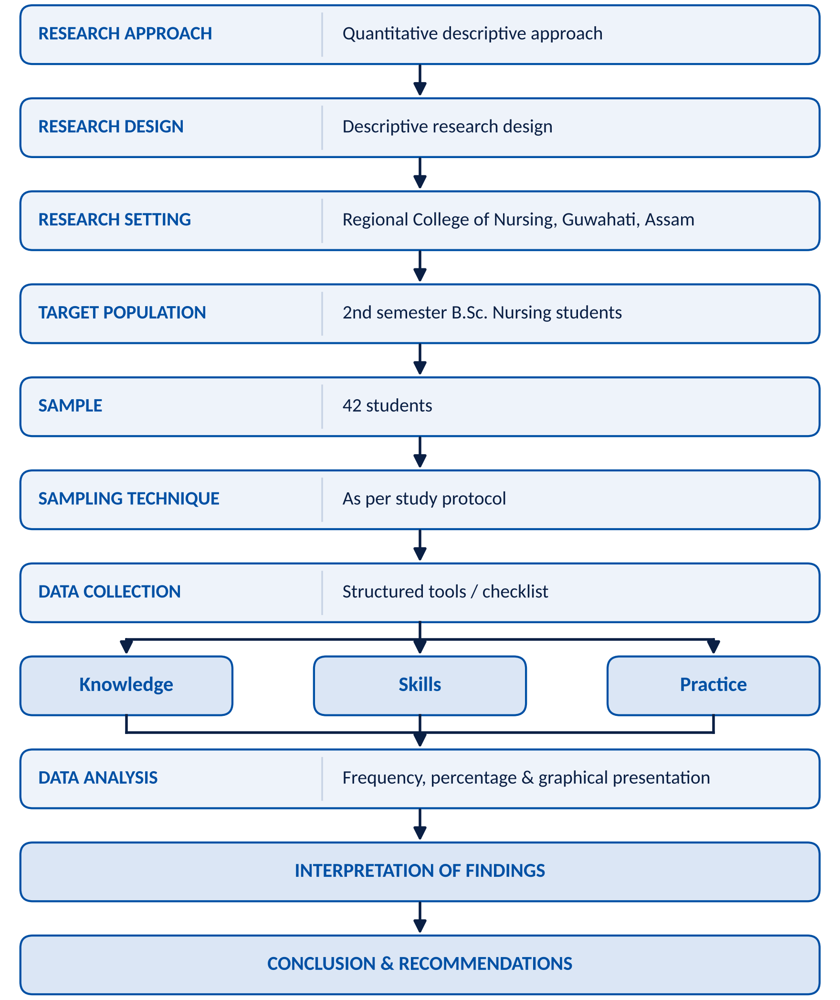
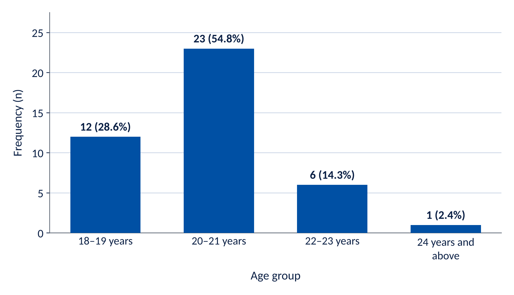
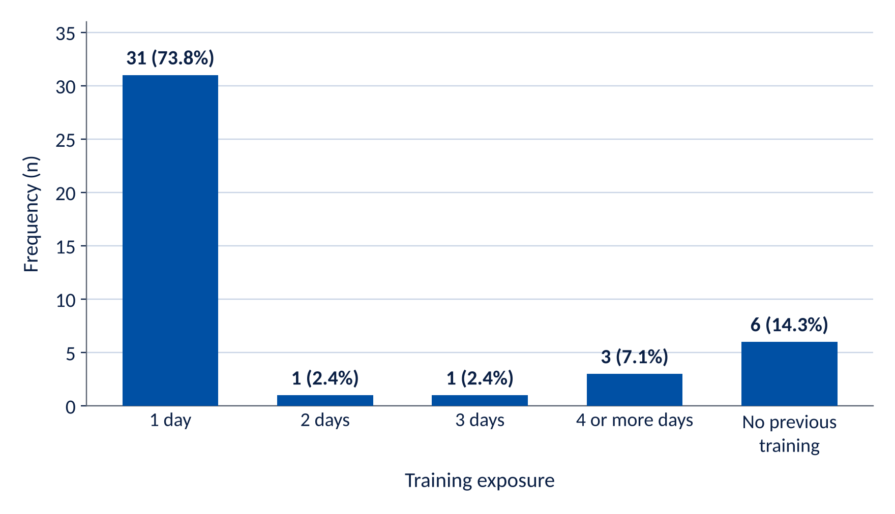
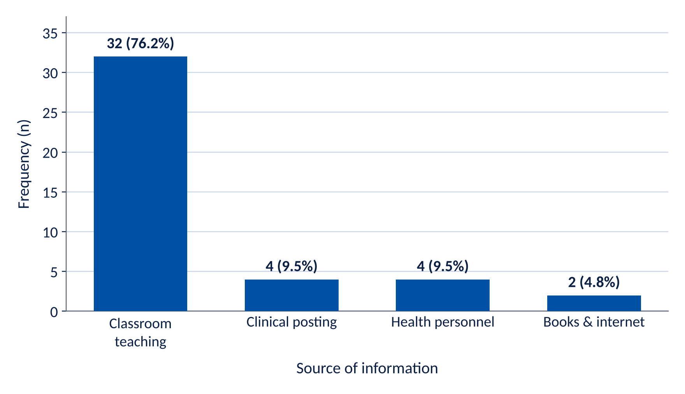
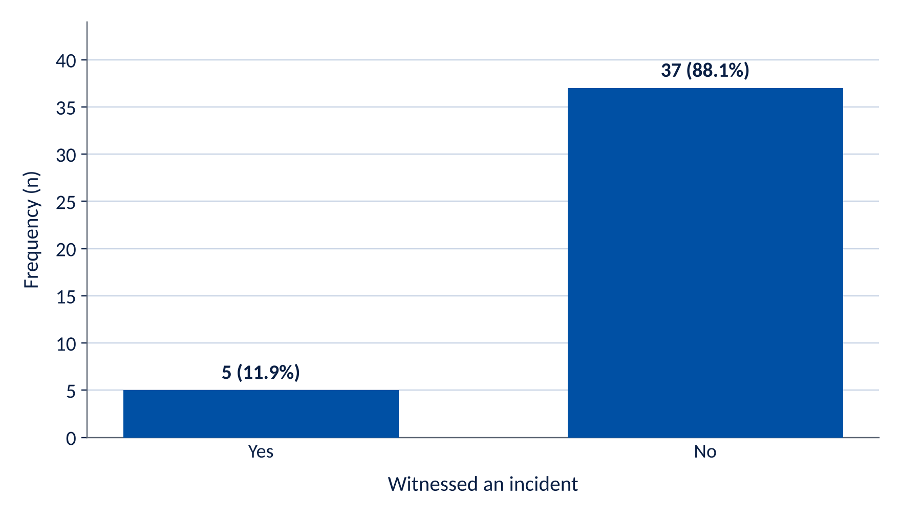
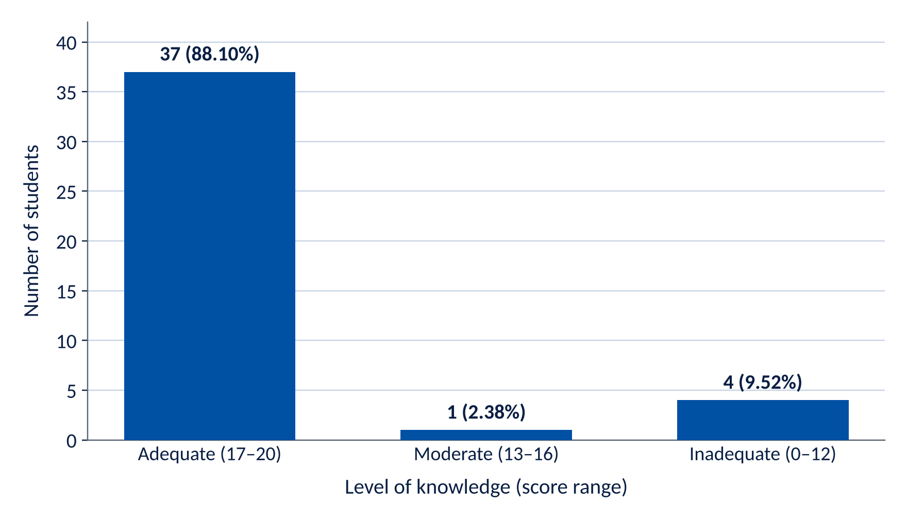
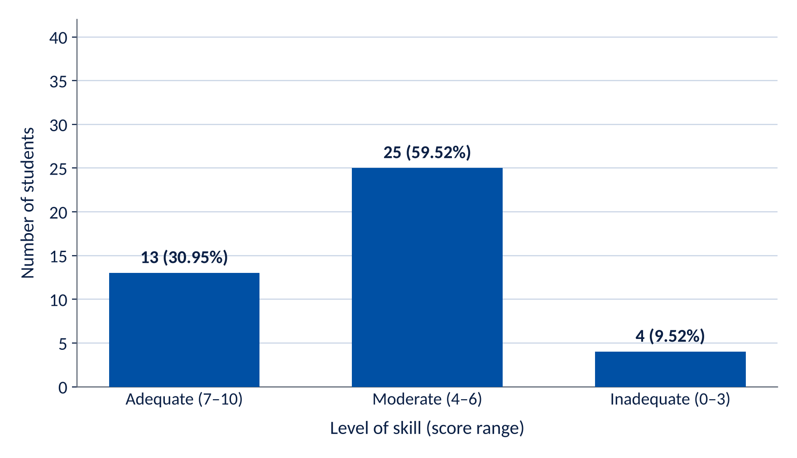
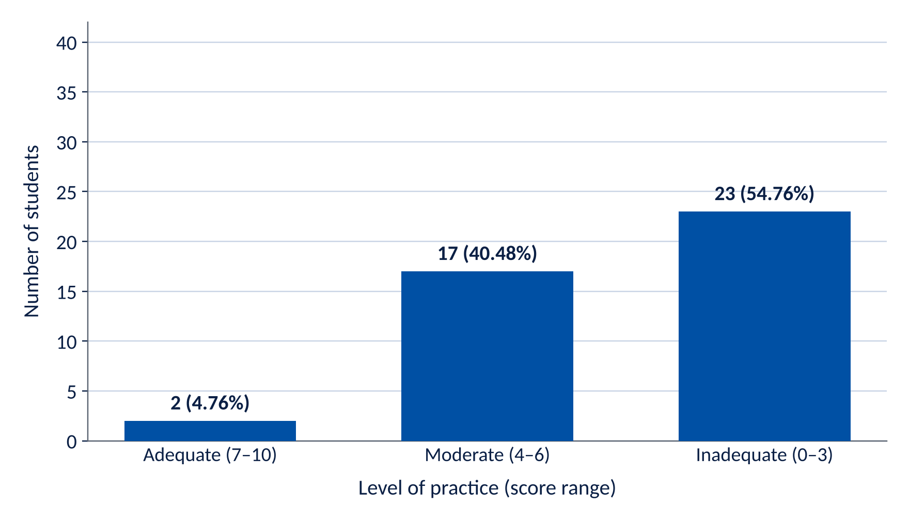
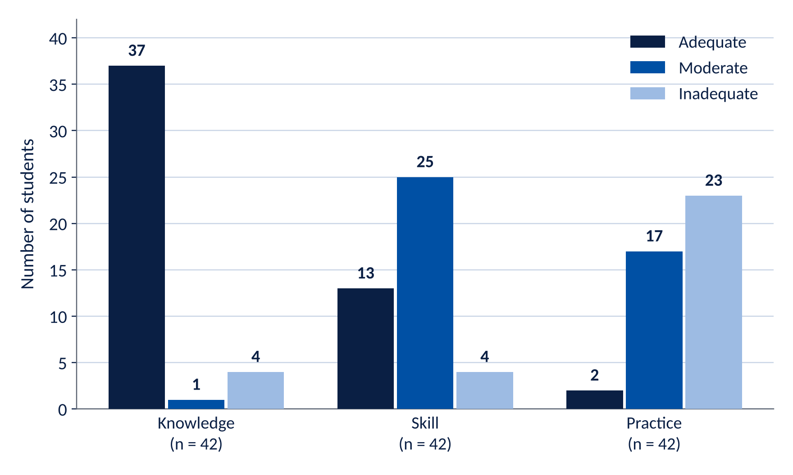

## Introduction

Patient safety is a fundamental component of quality healthcare and an essential responsibility of every healthcare professional. It refers to the prevention of avoidable harm to patients during the process of healthcare delivery. Safe patient care requires accurate assessment, effective communication, proper infection prevention, safe medication administration, correct patient identification, prevention of falls, appropriate documentation, and timely reporting of errors or adverse events.

Nursing education provides students with opportunities to learn patient-safety principles in the classroom and apply them during clinical practice. However, students may face challenges in transferring theoretical knowledge into clinical practice because of limited experience, unfamiliar clinical environments, communication difficulties, workload, and inadequate supervision. Regular assessment of students' knowledge, skills, and practices can help identify areas requiring improvement^1^.

Patient-safety education is particularly important for second-semester B.Sc. Nursing students, as they are beginning to develop and apply fundamental clinical competencies. Early identification of gaps in patient-safety knowledge and practice can help nursing educators provide appropriate teaching, demonstration, supervision, and reinforcement.

Therefore, the present study was undertaken to assess patient safety among 42 second-semester B.Sc. Nursing students of Regional College of Nursing, Guwahati, Assam, with emphasis on their knowledge, skills, and practice related to patient safety. The study aims to provide useful information for strengthening patient-safety education and promoting safe and quality nursing care.

### Need for the study

Patient safety is an essential component of quality nursing care. Nurses are directly involved in many activities that can affect patient safety, including medication administration, infection prevention, patient identification, communication, documentation, prevention of falls, and monitoring of patients. Therefore, nursing students need to develop appropriate knowledge, skills and attitudes related to patient safety before becoming independent practitioners^2^.

The World Health Organization (WHO) recommends that patient safety should be incorporated into the education of nursing and other health-profession students. Its patient-safety curriculum includes areas such as teamwork, learning from errors, clinical-risk management, infection prevention and control, invasive procedures and medication safety.

Nursing students are exposed to real clinical situations during their training. Although theoretical knowledge is important, students must also be able to apply safety principles correctly during clinical practice. Previous evidence indicates that the clinical learning environment, active participation, supervision and feedback can influence the development of patient-safety competencies among undergraduate nursing students.

Patient-safety education is particularly important for students in the early semesters of B.Sc. Nursing because they are beginning to develop fundamental clinical skills and professional behaviours. Early identification of gaps in knowledge and practice can allow nursing educators to provide additional demonstrations, supervised practice, simulation and corrective feedback before students take on greater clinical responsibilities.

Patient-safety competencies also involve more than simply knowing the correct procedure. Students need to understand how communication, teamwork, clinical systems and human factors can contribute to or prevent patient harm. Current evidence continues to emphasize identifying gaps in patient-safety competencies among nursing students and strengthening nursing education accordingly.

Therefore, assessing patient safety among B.Sc. Nursing students is important for determining whether students possess adequate knowledge and are able to apply safety principles during clinical practice. The findings can help nursing educators identify areas of weakness and plan appropriate educational interventions.

### Problem statement

"A study to assess the knowledge, skills and practice regarding patient safety in clinical practices among 2nd semester B.Sc. Nursing students of Regional College of Nursing, Guwahati, Assam."

### Assumptions

The study is based on the following assumptions:

1. It is assumed that B.Sc. Nursing students have some basic knowledge and awareness regarding patient safety and safe clinical practices.
2. It is assumed that nursing students' patient-safety practices may vary according to their knowledge, clinical exposure, training, and experience.
3. It is assumed that regular clinical supervision and guidance by nursing faculty and clinical staff can improve patient-safety practices among nursing students.
4. It is assumed that assessment of patient-safety practices will help identify areas requiring further education, training, and supervision among nursing students.
5. It is assumed that improving patient-safety practices among nursing students will contribute to the delivery of safe, effective, and quality nursing care.

### Delimitation

The study is delimited to government nursing colleges of Assam.

## Review of Literature

### Introduction

A review of literature is a systematic examination of published and available information related to the research problem. It helps the researcher understand the existing knowledge, identify gaps in previous studies and provide a scientific basis for the present investigation.

Patient safety is an essential component of quality nursing care. Nursing students need adequate knowledge, clinical skills, communication abilities and appropriate safety attitudes to provide safe care. Patient-safety education during undergraduate nursing education can help students recognize risks, prevent errors and develop safe clinical practices.

### Literature related to patient safety

The World Health Organization (WHO) developed the Multi-professional Patient Safety Curriculum Guide to support patient-safety education in universities and health-professional schools, including nursing. The guide includes major areas such as understanding human factors, teamwork, learning from errors, clinical-risk management, quality improvement, patient engagement, infection prevention, invasive procedures and medication safety.

Patient safety is therefore not limited to preventing individual errors; it also involves understanding health-care systems, communication, teamwork, clinical risks and organizational factors. Incorporating these concepts into undergraduate nursing education is important because students develop their professional behaviours and clinical competencies during their training.

### Literature related to patient-safety education among nursing students

Farokhzadian et al. (2024) conducted a cross-sectional study among 215 nursing students in Iran to assess patient-safety competencies in classroom and clinical settings. The researchers used the Health Professional Education in Patient Safety Survey. The mean overall scores were 3.50 ± 0.55 in classroom settings and 3.45 ± 0.57 in clinical settings. Clinical safety had the highest scores in both settings. However, students reported lower confidence in some areas of safety culture and understanding human and environmental factors. The researchers concluded that existing educational programmes provide opportunities for developing patient-safety competencies, but additional teaching strategies and clinical approaches are required.

The same study found that approximately 84.65% of students agreed or strongly agreed that they had learned about patient-safety competencies in the classroom, while 83.25% reported this for clinical settings. The findings demonstrate that both classroom teaching and clinical exposure contribute to patient-safety learning.

### Literature related to the gap between knowledge and clinical practice

Previous literature indicates that students may feel more confident about theoretical or clinical-safety aspects than about the broader sociocultural components of patient safety. A review discussed by Farokhzadian et al. identified concerns regarding the limited integration of areas such as human factors and patient-safety concepts into nursing curricula. The literature also emphasizes that the quality of the clinical learning environment can influence students' overall competence.

This is particularly important for second-semester nursing students because they are at an early stage of clinical education. Students may know the correct procedure theoretically but require repeated demonstration, return-demonstration, supervision and feedback before consistently performing it safely.

### Literature related to medication safety

Medication safety is an important component of patient safety in nursing practice. Nursing students should learn correct patient identification, medication rights, checking medication orders, preventing medication errors and reporting errors or near misses.

The WHO patient-safety curriculum specifically identifies improving medication safety as one of its 11 teaching topics. It also emphasizes learning from errors and clinical-risk management as important components of patient-safety education.

### Literature related to infection prevention and control

Infection prevention and control is another major component of patient safety. Appropriate hand hygiene, use of personal protective equipment, safe handling of biomedical waste and prevention of cross-infection are essential nursing responsibilities.

The WHO curriculum specifically includes infection prevention and control among the core patient-safety topics for health-professional education.

### Literature related to communication and teamwork

Effective communication and teamwork are essential for preventing errors and ensuring continuity of patient care. Communication failures during handover, medication administration and clinical procedures can contribute to patient-safety incidents.

The WHO patient-safety curriculum identifies being an effective team player as a specific area of patient-safety education. It also emphasizes patient engagement and learning from errors.

### Literature related to learning from errors and incident reporting

A positive safety culture encourages health professionals and students to identify hazards, report incidents and learn from mistakes rather than simply focusing on blame. Incident reporting can help health-care organizations identify system weaknesses and develop preventive measures.

The WHO curriculum includes "learning from errors to prevent harm" and "understanding and managing clinical risk" as core patient-safety topics.

### Literature related to educational interventions

A 2025 systematic review examined the effectiveness of educational interventions for developing patient-safety competencies among undergraduate nursing students. The review highlights the importance of educational strategies specifically designed to improve patient-safety competencies rather than relying only on traditional classroom teaching.

This supports the use of approaches such as simulation, case-based learning, clinical demonstration, return-demonstration, structured feedback and supervised clinical practice.

### Recent evidence on patient-safety competency

A 2026 analysis of 30 cross-sectional studies from 13 countries compared patient-safety competency among nurses and nursing students. It found that students generally reported higher competency scores than practicing nurses, but students also showed a gap between theoretical learning and practical application. Teamwork and responding to adverse events were among areas requiring attention. The authors recommended strengthening practical learning and interprofessional education.

### Research gap

The reviewed literature indicates that:

- Patient safety should be incorporated into undergraduate nursing education.
- Students generally acquire patient-safety knowledge through classroom and clinical education.
- Clinical safety knowledge may be stronger than some broader safety-culture competencies^4^.
- There may be a gap between theoretical knowledge and actual clinical performance.
- Simulation, supervised practice, feedback and competency-based assessment can strengthen patient-safety learning.
- More institutional-level studies are needed to identify the specific patient-safety learning needs of nursing students.

Therefore, the present study was undertaken to assess patient safety in clinical practices among 2nd-semester B.Sc. Nursing students of Regional College of Nursing, Guwahati, Assam, using a knowledge questionnaire together with recorded skill and practice scores.

### Need for the present study

The present study is needed for the following purposes:

1. To assess the existing knowledge of B.Sc. Nursing students regarding patient safety.
2. To assess clinical skills and practices related to patient safety.
3. To identify gaps between theoretical knowledge and clinical performance.
4. To improve students' confidence and competency in providing safe patient care.
5. To provide baseline information that can be used for planning^5^ future patient-safety education and training programmes.

## Methodology

1. **Research approach:** Quantitative
2. **Research design:** Descriptive
3. **Study setting:** Regional College of Nursing, Guwahati, Assam
4. **Population:** 2nd-semester B.Sc. Nursing students
5. **Sample:** 2nd-semester B.Sc. Nursing students
6. **Sample size:** 42 students
7. **Sampling technique:** Consecutive sampling technique
8. **Inclusion criteria:** 2nd-semester B.Sc. Nursing students who were willing to participate in the study.
9. **Exclusion criteria:** 2nd-semester B.Sc. Nursing students who were absent or not willing to participate.
10. **Variables of the study:**
    a. **Study variables:** Patient safety in clinical practices; knowledge, skill and practice.
    b. **Demographic variables:** Age, previous clinical experience, duration of training, source of information, witnessed patient-safety incidents^3^.
11. **Ethical considerations:**
    a. Permission was obtained from the concerned authority.
    b. Voluntary participation.
    c. Confidentiality and anonymity were maintained.

### Schematic diagram of the research methodology

### Data collection tools

1. Self-administered questionnaire
2. Interview schedule

## Results

### Analysis of demographic data

Table: Table 1. Age distribution (N = 42)

| Age group | Frequency (f) | Percentage (%) |
|:---|---:|---:|
| 18–19 years | 12 | 28.6 |
| 20–21 years | 23 | 54.8 |
| 22–23 years | 6 | 14.3 |
| 24 years and above | 1 | 2.4 |
| Total | 42 | 100 |

*Interpretation:* The majority of students, 23 (54.8%), were in the age group of 20–21 years. Twelve (28.6%) were aged 18–19 years, 6 (14.3%) were aged 22–23 years, and 1 (2.4%) was 24 years or above^6^.

Table: Table 2. Previous exposure to patient-safety training (N = 42)

| Previous training | Frequency (f) | Percentage (%) |
|:---|---:|---:|
| 1 day | 31 | 73.8 |
| 2 days | 1 | 2.4 |
| 3 days | 1 | 2.4 |
| 4 or more days | 3 | 7.1 |
| No previous training | 6 | 14.3 |
| Total | 42 | 100 |

*Interpretation:* The majority, 31 (73.8%), had previously received 1 day of patient-safety training. Six (14.3%) had no previous training, while 3 (7.1%) had received training for 4 or more days. Only 1 (2.4%) student each had received 2-day and 3-day training.

Table: Table 3. Source of information regarding patient safety (N = 42)

| Source | Frequency (f) | Percentage (%) |
|:---|---:|---:|
| Classroom teaching | 32 | 76.2 |
| Clinical posting | 4 | 9.5 |
| Health personnel | 4 | 9.5 |
| Books & internet | 2 | 4.8 |
| Total | 42 | 100 |

*Interpretation:* The major source of information regarding patient safety was classroom teaching, reported by 32 (76.2%) students. Clinical posting and health personnel were reported by 4 (9.5%) students each, while 2 (4.8%) students reported books and internet as their source.

Table: Table 4. Previous witnessing of a patient-safety incident (N = 42)

| Witnessed an incident | Frequency (f) | Percentage (%) |
|:---|---:|---:|
| Yes | 5 | 11.9 |
| No | 37 | 88.1 |
| Total | 42 | 100 |

*Interpretation:* The majority of students, 37 (88.1%), reported that they had not witnessed a patient-safety incident during clinical posting. Only 5 (11.9%) reported having witnessed an incident.

#### Overall demographic interpretation

Most participants were 20–21 years old (54.8%). A large majority had received one day of previous patient-safety training (73.8%), and classroom teaching was the predominant source of information (76.2%). Most students (88.1%) had not previously witnessed a patient-safety incident during clinical posting^7^.

### Data analysis for patient-safety scores

Table: Table 5. Distribution of students according to level of knowledge regarding patient safety (N = 42)

| Level of knowledge | Frequency (f) | Percentage (%) |
|:---|---:|---:|
| Adequate | 37 | 88.10 |
| Moderate | 1 | 2.38 |
| Inadequate | 4 | 9.52 |
| Total | 42 | 100.0 |

Mean knowledge score = 17.14

*Interpretation:* The majority of students, 37 (88.10%), had adequate knowledge regarding patient safety. Only 1 (2.38%) student had moderate knowledge, while 4 (9.52%) students had inadequate knowledge.

The mean knowledge score was 17.14 out of 20, indicating an overall high level of knowledge.

Table: Table 6. Distribution of students according to level of patient-safety skill (N = 42)

| Level of skill | Frequency (f) | Percentage (%) |
|:---|---:|---:|
| Adequate | 13 | 30.95 |
| Moderate | 25 | 59.52 |
| Inadequate | 4 | 9.52 |
| Total | 42 | 100.0 |

Mean skill score = 5.74

*Interpretation:* More than half of the students, 25 (59.52%), demonstrated moderate skills related to patient safety. 13 (30.95%) had adequate skills, whereas 4 (9.52%) had inadequate skills.

The mean skill score was 5.74 out of 10, indicating that skills were predominantly at a moderate level.

Table: Table 7. Distribution of students according to level of patient-safety practice (N = 42)

| Level of practice | Frequency (f) | Percentage (%) |
|:---|---:|---:|
| Adequate | 2 | 4.76 |
| Moderate | 17 | 40.48 |
| Inadequate | 23 | 54.76 |
| Total | 42 | 100.0 |

Mean practice score = 3.57

*Interpretation:* The majority of students, 23 (54.76%), demonstrated inadequate patient-safety practice. 17 (40.48%) had moderate practice, while only 2 (4.76%) demonstrated adequate practice.

The mean practice score was 3.57 out of 10, indicating that patient-safety practices require considerable improvement.

### Overall analysis

Table: Table 8. Overall analysis of knowledge, skill and practice regarding patient safety (N = 42)

| Domain | Mean score | Predominant level | Percentage (%) |
|:---|---:|:---|---:|
| Knowledge | 17.14 | Adequate | 88.10 |
| Skill | 5.74 | Moderate | 59.52 |
| Practice | 3.57 | Inadequate | 54.76 |

#### Overall interpretation

**Major finding:** The data show a clear difference between the three domains:

- Knowledge → High (88.10% adequate)
- Skill → Mainly moderate (59.52% moderate)
- Practice → Mainly inadequate (54.76% inadequate)

This suggests that although the students possess good theoretical knowledge about patient safety, this knowledge is not being translated adequately into clinical skills and regular patient-safety practices.

## Discussion

The present study was conducted to assess knowledge, skills, and practice regarding patient safety among 42 second-semester B.Sc. Nursing students of Regional College of Nursing, Guwahati, Assam.

The analysis showed that knowledge was the strongest dimension. Among the 42 students, 37 (88.10%) had adequate knowledge, 1 (2.38%) had moderate knowledge, and 4 (9.52%) had inadequate knowledge. This indicates that most students had a satisfactory theoretical understanding of patient-safety principles^8^.

In contrast, the assessment of skills showed that 13 (30.95%) students had adequate skills, 25 (59.52%) had moderate skills, and 4 (9.52%) had inadequate skills. The predominance of moderate skill levels suggests that students may understand the principles of patient safety but require more opportunities to practice and demonstrate these skills under supervision.

The findings for practice were less satisfactory. Only 2 (4.76%) students demonstrated adequate practice, whereas 17 (40.48%) had moderate practice and 23 (54.76%) had inadequate practice. This indicates that the application of patient-safety principles in clinical practice is the major area requiring improvement.

The comparison of the three dimensions demonstrates a clear knowledge–skill–practice gap. Although 88.10% of students had adequate knowledge, only 30.95% had adequate skills and 4.76% had adequate practice. This suggests that theoretical knowledge alone does not guarantee appropriate clinical application.

The findings may be related to the students' limited clinical experience, developing confidence, insufficient opportunities for repeated practice, and the need for continuous clinical supervision. Therefore, nursing educators should emphasize demonstration, return demonstration, simulation-based learning, bedside teaching, supervised clinical practice, and regular feedback.

Overall, the analysis indicates that the students possess a good theoretical foundation in patient safety, but their clinical skills and especially their practical application need strengthening. Continuous patient-safety education and structured clinical supervision may help reduce the knowledge–practice gap and prepare students to provide safe and quality nursing care.

## Summary

The present study was conducted to assess knowledge, skills, and practice regarding patient safety among 42 second-semester B.Sc. Nursing students of Regional College of Nursing, Guwahati, Assam. A quantitative descriptive approach was adopted, and data were collected using appropriate assessment tools covering the three dimensions of patient safety^9^. The collected data were analyzed using frequency, percentage, and mean scores and presented through tables and figures.

The findings showed that knowledge was the strongest domain. Out of 42 students, 37 (88.10%) had adequate knowledge, 1 (2.38%) had moderate knowledge, and 4 (9.52%) had inadequate knowledge. Regarding skills, 13 (30.95%) students had adequate skills, 25 (59.52%) had moderate skills, and 4 (9.52%) had inadequate skills. Regarding practice, only 2 (4.76%) students demonstrated adequate practice, 17 (40.48%) had moderate practice, and 23 (54.76%) had inadequate practice.

The overall findings demonstrate a clear knowledge–skill–practice gap. Although the majority of students possessed adequate theoretical knowledge, their clinical skills were predominantly moderate and their patient-safety practices were predominantly inadequate. This indicates that theoretical knowledge alone is not sufficient to ensure safe clinical practice^10^.

Therefore, the study concludes that there is a need to strengthen the practical application of patient-safety principles among nursing students. Demonstration, return demonstration, simulation-based learning, supervised clinical practice, bedside teaching, regular observation, and continuous feedback should be incorporated into nursing education.

Overall, strengthening knowledge, clinical skills, and safe practices simultaneously can improve students' competence and confidence in patient care^11^. Early and continuous emphasis on patient safety during the B.Sc. Nursing programme can help students develop safe professional practices and contribute to quality nursing care, prevention of avoidable harm, and improved patient outcomes.

## Conclusion

Hence, the investigator felt the need to conduct the study entitled "Patient safety in clinical practices among B.Sc. Nursing Students of Regional College of Nursing, Guwahati, Assam". The study may provide useful information about students' patient-safety knowledge and clinical performance and may help in improving patient-safety education and clinical supervision.

## References

1. Potter, P. A., Perry, A. G., Stockert, P. A., & Hall, A. M. (2021). *Fundamentals of nursing* (10th ed.). Elsevier.
2. Hinkle, J. L., & Cheever, K. H. (2022). *Brunner & Suddarth's textbook of medical-surgical nursing* (15th ed.). Wolters Kluwer.
3. Basavanthappa, B. T. (2007). *Nursing research* (2nd ed.). Jaypee Brothers Medical Publishers.
4. Wood, M. J., Ross-Kerr, J. C., & Polit, D. F. (2021). *Nursing research: Generating and assessing evidence for nursing practice* (11th ed.). Wolters Kluwer.
5. Wood, M. J., & Ross-Kerr, J. C. (2011). *Basic steps in planning nursing research: From question to proposal* (7th ed.). Jones & Bartlett Learning.
6. Polit, D. F., & Beck, C. T. (2021). *Nursing research: Generating and assessing evidence for nursing practice* (11th ed.). Wolters Kluwer.
7. Kothari, C. R., & Garg, G. (2019). *Research methodology: Methods and techniques* (4th ed.). New Age International Publishers.
8. World Health Organization. (2021). *Global patient safety action plan 2021–2030: Towards eliminating avoidable harm in health care*. <https://www.who.int/publications/i/item/9789240032705>
9. World Health Organization. (2024). *Global patient safety report 2024*. <https://www.who.int/publications/i/item/9789240095458>
10. World Health Organization. (2009). *WHO guidelines on hand hygiene in health care*. <https://www.who.int/publications/i/item/9789241597906>
11. Ministry of Health and Family Welfare, Government of India. (n.d.). *National quality assurance standards for district hospitals*.
