## Introduction

Stress is a common psychological response that occurs when an individual perceives that the demands placed upon them exceed their ability to cope^1^. A certain amount of stress may motivate students to perform better; however, excessive or prolonged stress can negatively affect their physical, psychological, social, and academic well-being^2^. Nursing students may experience stress due to heavy academic workload, clinical responsibilities, fear of examinations, time constraints, interpersonal relationships, lack of sleep, financial concerns, and uncertainty regarding their future career.

At this stage, students may experience additional pressure related to final examinations, clinical performance, research work, completion of academic requirements, and expectations regarding employment and professional responsibilities^3^. If stress is not appropriately recognized and managed, it may affect concentration, academic performance, confidence, clinical competence, and overall quality of life.

### Background of the study

The present study is undertaken to assess the level of stress among B.Sc. Nursing students of a selected nursing institute, Guwahati, Assam. Nursing education is a demanding professional programme in which students are required to manage theoretical learning, clinical practice, assignments, examinations, research activities, and patient-care responsibilities.

Stress is an important concern among nursing students because continuous academic and clinical demands may affect their physical, psychological, social, and academic well-being. Students in the 8th semester may experience additional stress as they approach the completion of their course and prepare for final examinations, professional responsibilities, employment, and transition from student to staff nurse.

The purpose of this study is to determine the level of stress experienced by B.Sc. Nursing students and to identify the extent to which stress is present among them. The study will provide useful information regarding the stress experienced by students during this important stage of their nursing education.

The study will be conducted among B.Sc. Nursing students of a selected institute, Guwahati, Assam. A suitable standardized or structured stress assessment tool will be used to assess the students' level of stress. The collected data will be systematically analysed and interpreted according to the objectives of the study.

The findings of the study may help nursing teachers and administrators understand the stress experienced by students and plan appropriate measures such as counselling, stress-management education, relaxation techniques, time-management strategies, peer support, and other supportive interventions. Ultimately, the study may contribute to improving the psychological well-being, academic performance, clinical learning, and professional preparedness of B.Sc. Nursing students.

### Need of the study

Nursing is a profession that requires students to develop sound theoretical knowledge, clinical competence, communication skills, and professional responsibility. During their nursing education, students are exposed to various academic and clinical demands that may contribute to stress. Stress is a natural response to challenging situations, but excessive or prolonged stress may adversely affect students' physical health, psychological well-being, academic performance, and clinical learning^4^.

B.Sc. Nursing students face several stress-producing situations, such as heavy academic workload, examinations, assignments, clinical postings, patient-care responsibilities, time constraints, long working hours, lack of adequate rest, fear of making mistakes, and difficulties in balancing academic and personal responsibilities. These challenges may become more significant as students near the completion of their course and face final examinations, clinical responsibilities, research work, and preparation for their future professional career^5^.

The pressure to perform well academically and clinically may increase feelings of anxiety, tension, frustration, and emotional exhaustion. High levels of stress may result in poor concentration, disturbed sleep, reduced motivation, decreased academic performance, and difficulty in providing effective patient care.

Assessing stress among nursing students is important because early identification of stress can help educators understand the problems faced by students and provide appropriate support. Counselling, stress-management programmes, relaxation techniques, time-management education, peer support, and a supportive academic and clinical environment may help students cope more effectively with stress.

Therefore, I (the researcher) felt the need to conduct a study entitled “A Study to Assess the Level of Stress among B.Sc. Nursing Students in a Selected Nursing Institute of Guwahati, Assam”^6^. The findings of the study may help nursing educators and administrators understand the level of stress among students and plan appropriate measures to promote their psychological well-being, academic achievement, clinical competence, and successful transition into professional nursing practice.

### Problem statement

“A Study to Assess the Level of Stress among B.Sc. Nursing Students in a Selected Nursing Institute of Guwahati, Assam”

### Objectives of the study

1. To assess the level of stress among the B.Sc. Nursing students in the selected nursing institute.
2. To determine the association between stress levels and selected socio-demographic variables such as age, residence, family type, previous academic performance, number of family members, birth order, history of academic failure, parents' education and current financial support.

### Operational definitions

1. **Stress:** The physical, emotional, and psychological response experienced by 8th-semester B.Sc. Nursing students due to academic, personal, and environmental factors, measured by a standardized stress scale, that is, the stress assessment tool Perceived Stress Scale (PSS-10).
2. **8th-semester B.Sc. Nursing students:** Students studying in the 8th semester of the B.Sc. Nursing programme at Regional College of Nursing, Guwahati, Assam, under SSUHS.

### Assumptions

For the research topic “A Study to Assess the Level of Stress among B.Sc. Nursing Students in a Selected Nursing Institute of Guwahati, Assam”, the following assumptions were made:

1. B.Sc. Nursing students experience stress during their course in the selected nursing institute of Guwahati, Assam.
2. Academic and personal factors contribute to stress levels in the selected nursing institute of Guwahati, Assam.
3. Students will provide honest responses in the selected nursing institute of Guwahati, Assam.

### Research hypotheses

1. **H1:** There is a significant level of stress among B.Sc. Nursing students.
2. **H2:** There is a significant association between stress levels and selected socio-demographic variables.

### Delimitations

For the research topic “A Study to Assess the Level of Stress among B.Sc. Nursing Students in a Selected Nursing Institute of Guwahati, Assam”, the following delimitations were set:

1. The study will be limited to B.Sc. Nursing students.
2. The study will be conducted only at Regional College of Nursing, Guwahati, Assam.
3. Data collection will be limited to the selected period.

## Review of Literature

For the study “A Study to Assess the Level of Stress among B.Sc. Nursing Students in a Selected Nursing Institute of Guwahati, Assam”, the review of literature is organized into the following sections^7^.

### Literature related to stress among nursing students

Nursing education involves academic learning, clinical practice, examinations, assignments, patient-care responsibilities and professional skill development. These demands can expose nursing students to considerable psychological stress.

A systematic review and analysis published in 2022 examined stress among nursing students using validated stress-assessment instruments. The review included studies involving 9,202 participants and reported that stress among nursing students was predominantly at a moderate level. The Perceived Stress Scale (PSS) was among the commonly used instruments in the included studies^8^.

### Literature related to perceived stress among undergraduate nursing students

A descriptive cross-sectional study conducted among 282 undergraduate nursing students in North India assessed perceived stress using the Perceived Stress Scale. The study reported a mean perceived stress score of 28.67 ± 5.32. Female students had a higher mean perceived stress score than male students, and differences were also observed across academic years. The researchers concluded that nursing students experienced considerable psychological stress and recommended measures to reduce stress among students.

This study is particularly relevant to the present research because it was conducted in India and used the Perceived Stress Scale, which is also the instrument used in the present study.

### Literature related to clinical stress among nursing students

Clinical practice is an important component of nursing education but can also be a significant source of stress. A systematic review published in 2023 examined the relationship between perceived clinical stress and clinical performance among prelicensure nursing students. The review identified gender, academic year and clinical skill preparation as important themes and noted that sustained clinical stress may affect students' perceptions of competence, confidence and clinical performance.

A 2021 instrument-development study involving 430 nursing students identified several important clinical stressors, including inadequate knowledge and skills, inappropriate clinical environments, limitations in clinical instruction, inappropriate instructor conduct and concerns regarding nursing as a career. The findings demonstrate that stress among nursing students can arise from multiple academic and clinical factors rather than from a single source.

### Literature related to sources of stress and coping

An umbrella review published in 2024 concluded that prelicensure nursing students experience significant stress associated with both their educational programme and clinical placements. The review highlighted the importance of effective coping mechanisms to help students manage academic and clinical responsibilities and to support their well-being and academic performance.

### Literature related to stress assessment using PSS-10

The Perceived Stress Scale (PSS) is widely used to assess the degree to which individuals perceive situations in their lives as stressful. Recent systematic-review evidence shows that the PSS-10 is one of the commonly used instruments for assessing stress among undergraduate nursing students. A 2026 systematic review identified PSS-based studies as an important group of studies in the nursing-student stress literature.

### Research gap

The literature indicates that stress is a significant concern among nursing students and may be associated with academic demands, clinical experiences, preparation for professional practice and other personal or contextual factors. However, stress levels can differ according to academic year, institution, clinical environment, geographical location and measurement instrument.

Therefore, there is a need to assess perceived stress specifically among B.Sc. Nursing students at Regional College of Nursing, Guwahati, Assam. The present study has helped determine the level of perceived stress among students at this particular stage of nursing education and may provide a basis for appropriate stress-management and supportive interventions.

### Summary of review of literature and relevance to the present study

1. **Stress among nursing students:** Nursing students experience substantial stress — establishes the importance of the problem.
2. **Perceived stress in Indian nursing students:** High perceived stress was reported among undergraduate nursing students in North India — provides Indian evidence.
3. **Clinical stress:** Clinical environment, skills and academic year influence stress — relevant to nursing students.
4. **Sources and coping:** Academic and clinical responsibilities are major stressors — supports the need for stress-management measures.
5. **PSS-10 assessment:** PSS is commonly used to measure perceived stress — supports the selection of PSS-10 for the study.
6. **Research gap:** Stress varies by context and academic stage.

## Study Overview

### Background

Stress is an important concern among nursing students because of the multiple academic, clinical and personal demands associated with nursing education. Students are required to manage theoretical learning, clinical postings, practical examinations, assignments, patient-care responsibilities and preparation for professional practice. The final semester may be particularly demanding because students are approaching completion of their course and transition into professional nursing practice. Persistent or excessive stress may negatively affect students' concentration, academic performance, clinical competence, psychological well-being and overall quality of life. Therefore, assessment of perceived stress among final-semester nursing students is important for identifying students who may require appropriate support and stress-management interventions.

### Aim of the study

The aim of the study was to assess the level of perceived stress among B.Sc. Nursing students in a selected nursing institute of Guwahati, Assam.

### Objectives

1. To assess the level of stress among B.Sc. Nursing students in the selected nursing institute of Guwahati, Assam.
2. To describe the selected demographic characteristics of the study participants in the selected nursing institute of Guwahati, Assam.
3. To determine the distribution of students according to low, moderate and high levels of perceived stress in the selected nursing institute of Guwahati, Assam.
4. To calculate the mean and standard deviation of the PSS-10 scores among the study participants in the selected nursing institute of Guwahati, Assam.

### Methodology

A quantitative descriptive research approach was adopted for the study “A Study to Assess the Level of Stress among B.Sc. Nursing Students in a Selected Nursing Institute of Guwahati, Assam”.

The participants were assessed using a structured socio-demographic questionnaire and the 10-item Perceived Stress Scale (PSS-10).

The PSS-10 was used to measure the students' perceived stress. The total score ranges from 0 to 40, with higher scores indicating greater perceived stress. For the present analysis, scores were classified into low, moderate and high stress categories. The collected data were organized and analyzed using frequency, percentage, mean, median and standard deviation.

### Results

The socio-demographic findings showed that the largest proportion of students were 23 years old (42.22%), 48.89% were from urban areas, and 84.44% belonged to nuclear families. About 62.22% had 4–6 family members. Regarding academic characteristics, 80% of students had good academic performance and 80% had no history of academic failure or backlog. Parents/family were the source of financial support for 97.78% of the participants.

The PSS-10 analysis revealed that 8 students (17.78%) had low stress, 35 students (77.78%) had moderate stress, and 2 students (4.44%) had high stress. The overall mean PSS-10 score was 19.16 with a standard deviation of 6.31, and the median score was 21. Thus, moderate stress was the predominant level among the study participants.

## Research Methodology

**Research approach:** A quantitative research approach was adopted for the present study. This approach is appropriate because the study aims to objectively assess and quantify the level of stress among B.Sc. Nursing students^9^.

**Research design:** A descriptive research design was used to assess the level of stress among B.Sc. Nursing students.

**Setting of the study:** The study was conducted at Regional College of Nursing, Guwahati, Assam. The college provides undergraduate/postgraduate nursing education and clinical learning opportunities.

**Population:** The target population consisted of B.Sc. Nursing students studying at Regional College of Nursing, Guwahati, Assam^10^.

**Sample:** The sample comprised B.Sc. Nursing students who fulfilled the predetermined inclusion criteria and were available during the period of data collection.

**Sample size:** The sample size was determined according to the number of eligible B.Sc. Nursing students available in the selected setting and the requirements of the study. It was found to be 45.

**Sampling technique:** An appropriate sampling technique, such as total enumeration sampling or convenience sampling, was used to select the participants depending on the availability and eligibility of the students.

### Inclusion criteria

Students were included in the study if they:

- were studying in the 8th semester of B.Sc. Nursing at Regional College of Nursing, Guwahati, under SSUHS^11^;
- were willing to participate in the study; and
- were available during the period of data collection.

### Exclusion criteria

Students were excluded if they:

- were absent during data collection.

### Variables of the study

- **Research variable:** Level of stress in B.Sc. Nursing students at Regional College of Nursing, Guwahati, Assam.
- **Selected socio-demographic variables:** Age, residence, previous academic background, type of family, number of family members, birth order, history of academic failure, parents' education and current financial support.

### Data collection tool

Data were collected using two sections:

- **Section A: Socio-demographic variables.** Socio-demographic variables consist of age, residence, previous academic background, type of family, number of family members, birth order, history of academic failure, parents' education and current financial support.
- **Section B: Stress assessment scale (PSS-10).** A standardized stress assessment scale (PSS-10) was used to assess the level of stress among the students. The scoring and interpretation were carried out according to the instructions of the selected scale.

### Validity and reliability

The standard stress assessment scale PSS-10 was used for stress assessment.

The reliability of the tool was established using an appropriate reliability-testing method before the final data collection. The reliability of the tool is 0.79, and it is considered to be reliable and adequate.

### Data collection procedure

After obtaining permission from the concerned authority and informed consent from the participants, the researcher collected data from eligible B.Sc. Nursing students. The purpose of the study was explained to the participants. The questionnaire/stress assessment scale was administered, and sufficient time was provided for completion. Confidentiality and anonymity of the participants were maintained.

### Ethical considerations

1. The study was done after obtaining ethical approval from the Institutional Ethical Committee, Regional College of Nursing, Guwahati.
2. Verbal and written consent was obtained from all the participants of the study after explaining the purpose and other details of the study.
3. The participants were assured of the confidentiality of the data obtained and that participation was voluntary.

### Plan for data analysis

The collected data were organized, coded, tabulated, and analysed using descriptive and inferential statistics.

- **Descriptive statistics:** Frequency and percentage for socio-demographic variables. Mean and standard deviation for stress scores. Frequency and percentage for different levels of stress.
- **Inferential statistics:** Appropriate statistical tests, such as the chi-square test, were used to determine the association between the level of stress and selected socio-demographic variables, according to the nature of the data.

### Expected outcome

The study determined the level of stress among B.Sc. Nursing students and identified whether the stress level was low, moderate, or high according to the scoring criteria of the selected assessment tool. The findings may help nursing educators and administrators develop appropriate stress-management and supportive interventions for students.

### Schematic diagram

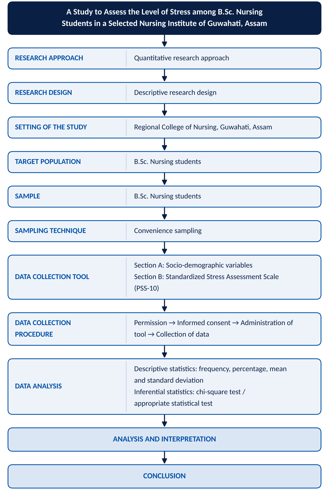

## Analysis and Interpretation

### Socio-demographic data

Table: Table 1. Distribution of students according to age (N = 45)

| Age | Frequency (f) | Percentage (%) |
|:---|---:|---:|
| 22 years | 10 | 22.22 |
| 23 years | 19 | 42.22 |
| 24 years | 10 | 22.22 |
| 25 years | 5 | 11.11 |
| 26 years | 1 | 2.22 |
| Total | 45 | 100 |

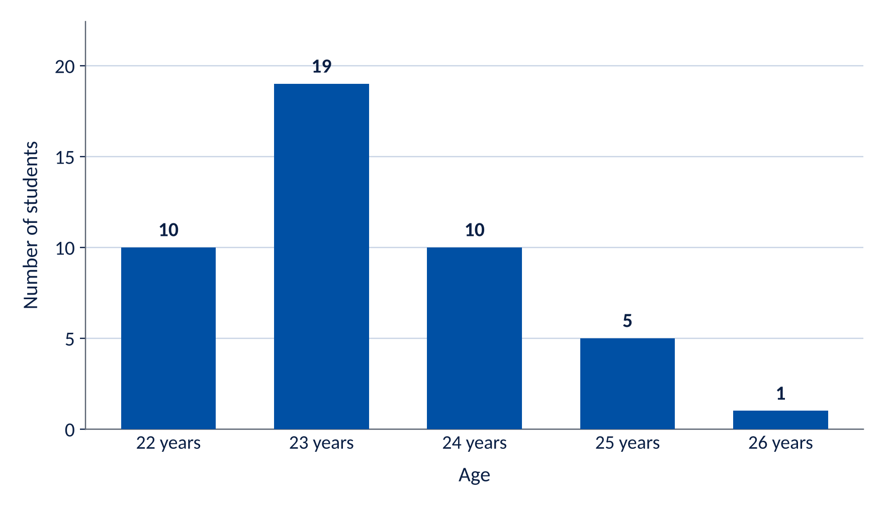

*Interpretation:* The majority of students, 19 (42.22%), were 23 years old. The least number, 1 (2.22%), were 26 years old.

Table: Table 2. Distribution of students according to place of residence (N = 45)

| Place of residence | Frequency (f) | Percentage (%) |
|:---|---:|---:|
| Urban | 22 | 48.89 |
| Rural | 16 | 35.56 |
| Semi-urban | 7 | 15.56 |
| Total | 45 | 100 |

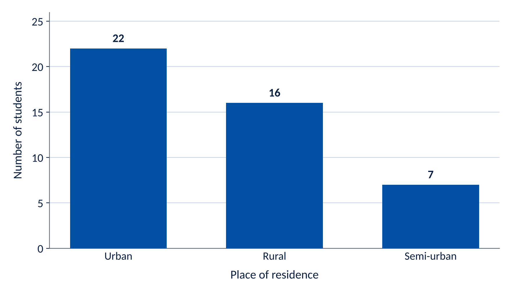

*Interpretation:* Nearly half of the students, 22 (48.89%), were from urban areas, while 7 (15.56%) were from semi-urban areas.

Table: Table 3. Distribution of students according to type of family (N = 45)

| Type of family | Frequency (f) | Percentage (%) |
|:---|---:|---:|
| Nuclear | 38 | 84.44 |
| Joint | 6 | 13.33 |
| Extended | 1 | 2.22 |
| Total | 45 | 100 |

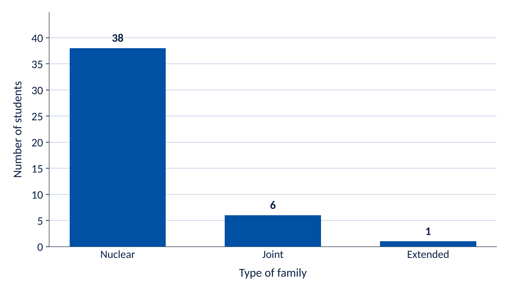

*Interpretation:* The majority, 38 (84.44%), belonged to nuclear families.

Table: Table 4. Distribution of students according to number of family members (N = 45)

| Number of family members | Frequency (f) | Percentage (%) |
|:---|---:|---:|
| 1–3 | 8 | 17.78 |
| 4–6 | 28 | 62.22 |
| 7 or more | 9 | 20.00 |
| Total | 45 | 100 |

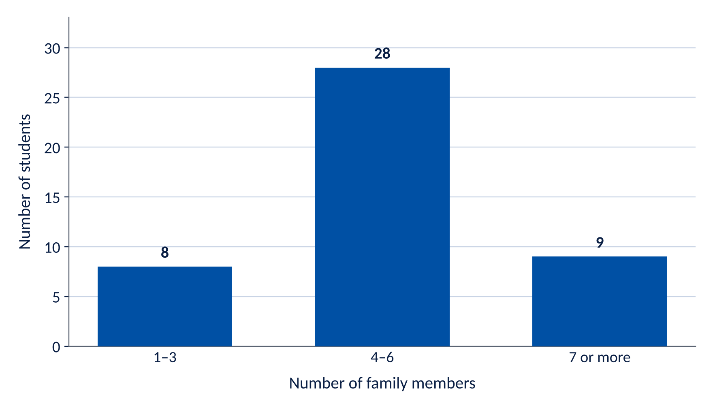

*Interpretation:* Most students, 28 (62.22%), had 4–6 members in their family.

Table: Table 5. Distribution of students according to birth order (N = 45)

| Birth order | Frequency (f) | Percentage (%) |
|:---|---:|---:|
| First | 20 | 44.44 |
| Second | 18 | 40.00 |
| Third | 2 | 4.44 |
| Fourth or above | 5 | 11.11 |
| Total | 45 | 100 |

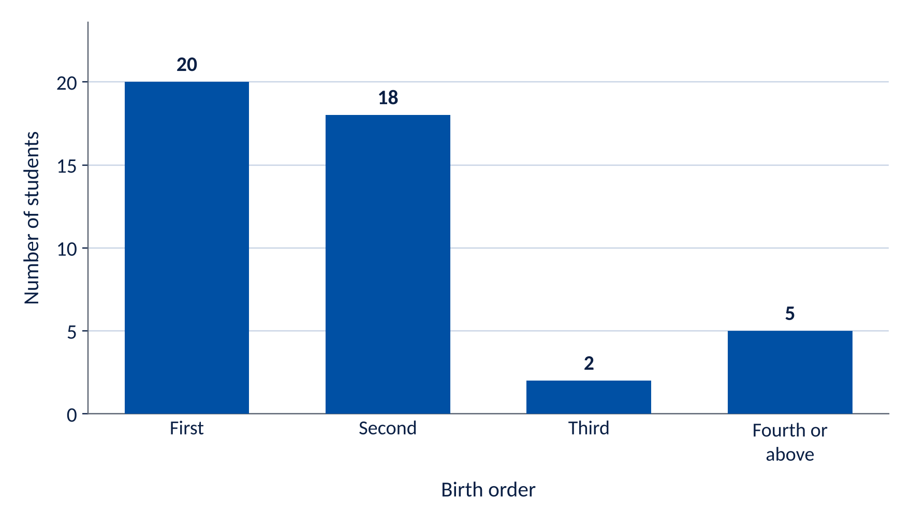

*Interpretation:* The highest proportion, 20 (44.44%), were first-born children, followed by 18 (40.00%) who were second-born.

Table: Table 6. Distribution of students according to academic performance in previous semester(s) (N = 45)

| Academic performance | Frequency (f) | Percentage (%) |
|:---|---:|---:|
| Excellent | 5 | 11.11 |
| Good | 36 | 80.00 |
| Average | 4 | 8.89 |
| Below average | 0 | 0 |
| Total | 45 | 100 |

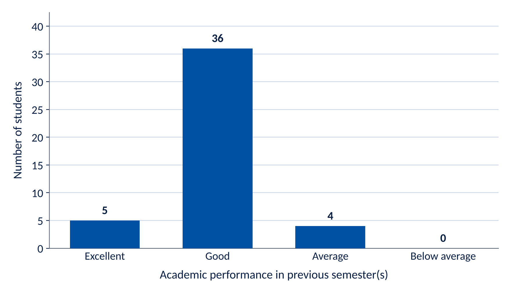

*Interpretation:* The majority of students, 36 (80.00%), had good academic performance in their previous semester(s). None of the students were categorized as below average.

Table: Table 7. Distribution of students according to history of academic failure/backlog (N = 45)

| Academic failure/backlog | Frequency (f) | Percentage (%) |
|:---|---:|---:|
| No | 36 | 80.00 |
| Yes | 9 | 20.00 |
| Total | 45 | 100 |

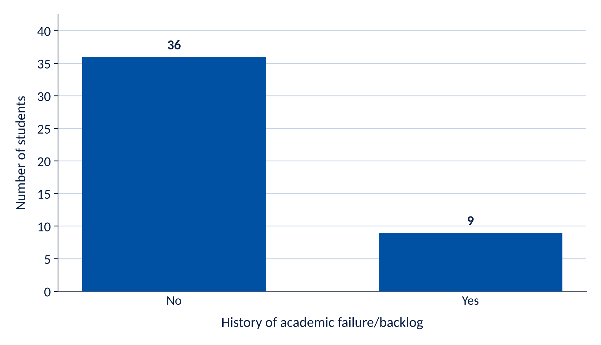

*Interpretation:* Most students, 36 (80.00%), reported no history of academic failure/backlog, whereas 9 (20.00%) reported a history of academic failure/backlog.

Table: Table 8. Distribution of students according to father's educational status (N = 45)

| Father's educational status | Frequency (f) | Percentage (%) |
|:---|---:|---:|
| No formal education | 0 | 0 |
| Primary education | 1 | 2.22 |
| Secondary education | 9 | 20.00 |
| Higher secondary education | 9 | 20.00 |
| Graduate | 22 | 48.89 |
| Postgraduate and above | 4 | 8.89 |
| Total | 45 | 100 |

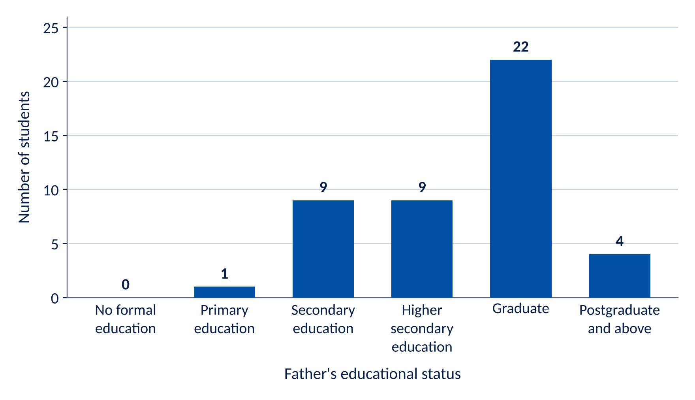

*Interpretation:* Nearly half of the students, 22 (48.89%), had fathers who were graduates. No father was recorded under no formal education.

Table: Table 9. Distribution of students according to mother's educational status (N = 45)

| Mother's educational status | Frequency (f) | Percentage (%) |
|:---|---:|---:|
| No formal education | 1 | 2.22 |
| Primary education | 3 | 6.67 |
| Secondary education | 8 | 17.78 |
| Higher secondary education | 20 | 44.44 |
| Graduate | 12 | 26.67 |
| Postgraduate and above | 1 | 2.22 |
| Total | 45 | 100 |

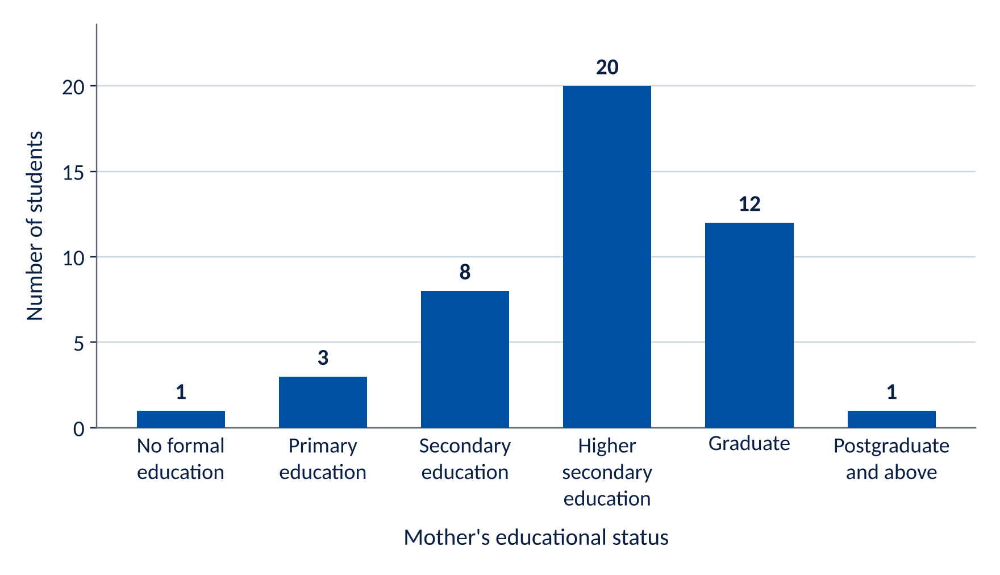

*Interpretation:* The largest proportion, 20 (44.44%), had mothers with higher secondary education, followed by 12 (26.67%) whose mothers were graduates.

Table: Table 10. Distribution of students according to current financial support for education (N = 45)

| Source of financial support | Frequency (f) | Percentage (%) |
|:---|---:|---:|
| Parents/family | 44 | 97.78 |
| Self | 0 | 0 |
| Scholarship | 1 | 2.22 |
| Educational loan | 0 | 0 |
| Other | 0 | 0 |
| Total | 45 | 100 |

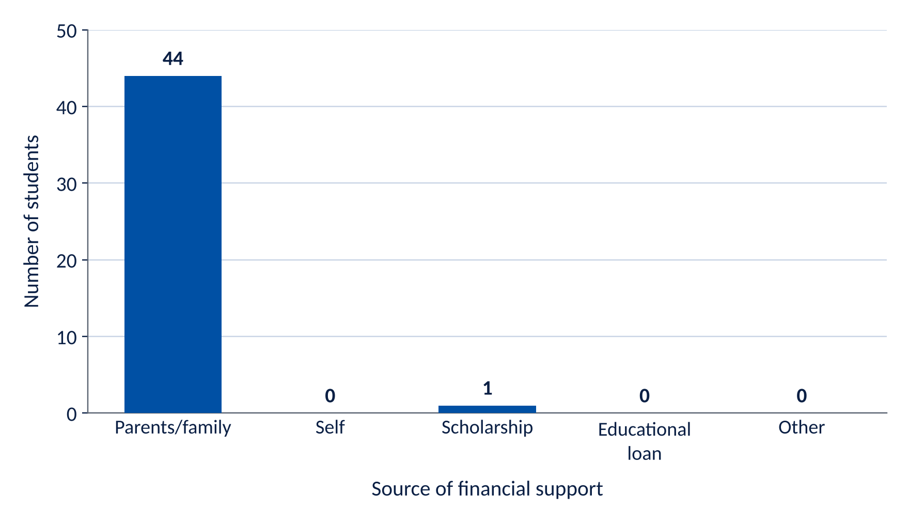

*Interpretation:* All 45 (100%) students reported that their education was financially supported by their parents/family.

#### Overall socio-demographic findings

The socio-demographic analysis of the 45 8th-semester B.Sc. Nursing students shows that the largest proportion were 23 years old (42.22%), lived in urban areas (48.89%), belonged to nuclear families (84.44%), had 4–6 family members (62.22%), were first-born (44.44%), and had good previous academic performance (80.00%). Most students had no history of academic failure/backlog (80.00%). Regarding parental education, fathers were most commonly graduates (48.89%), while mothers most commonly had higher secondary education (44.44%). All students reported parents/family as their source of financial support (100%).

### PSS-10 analysis

The PSS-10 was used to assess perceived stress. The total score ranges from 0–40. Higher scores indicate greater perceived stress.

Table: Table 11. Distribution of students according to level of perceived stress (N = 45)^12^

| Level of stress | PSS-10 score | Frequency (f) | Percentage (%) |
|:---|:---:|---:|---:|
| Low | 0–13 | 6 | 13.33 |
| Moderate | 14–26 | 33 | 73.33 |
| High | 27–40 | 6 | 13.33 |
| Total | | 45 | 100 |

*Note:* Mean = 19.16; SD = 5.65.

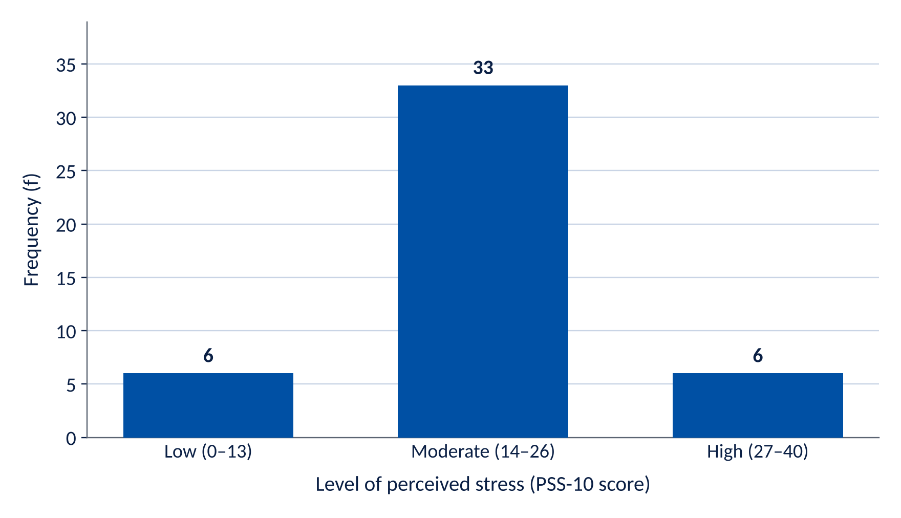

Table: Table 12. Percentage distribution of students according to PSS-10 stress level (N = 45)

| Low | Moderate | High |
|:---:|:---:|:---:|
| 13.33% | 73.33% | 13.33% |

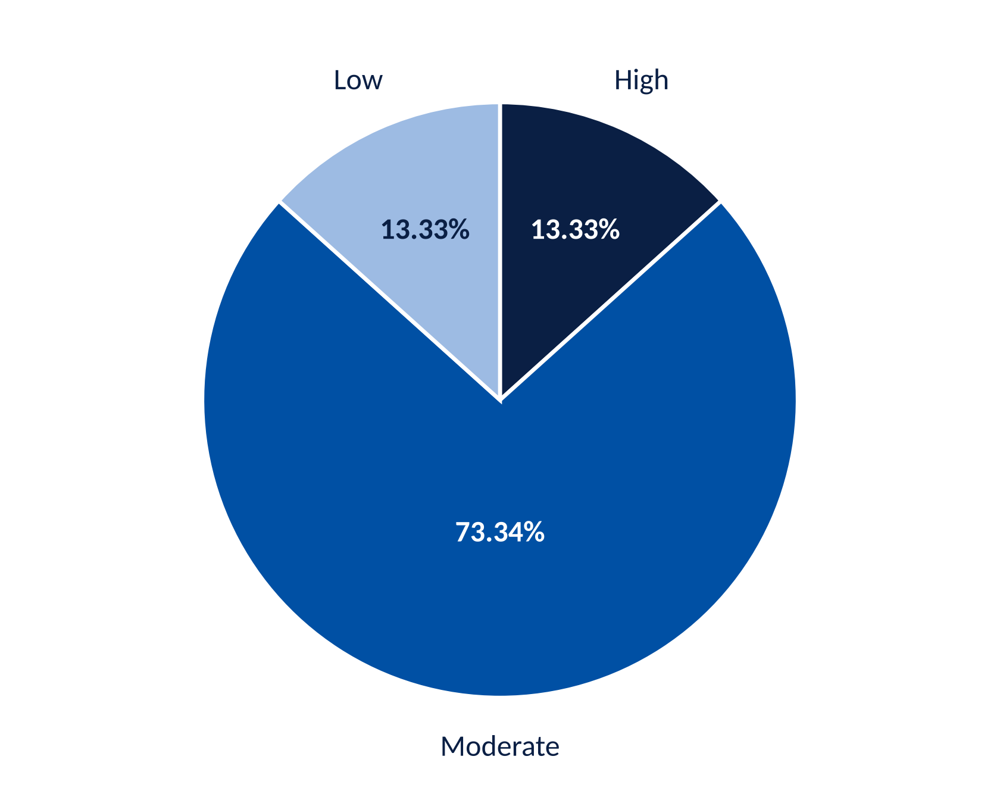

*Interpretation:* Table 11 and Figures 12 and 13 show that out of 45 B.Sc. Nursing students, the majority, 33 (73.33%), experienced moderate perceived stress. 6 (13.33%) students had low perceived stress, while 6 (13.33%) students had high perceived stress.

The findings indicate that moderate stress was the predominant level of perceived stress among the students.

### Descriptive statistics of PSS-10

Table: Table 13. Descriptive statistics of PSS-10 scores

| Number of students | Minimum score | Maximum score | Mean score | Median score |
|:---:|:---:|:---:|:---:|:---:|
| 45 | 4 | 30 | 19.16 | 19 |

## Discussion

The present study was conducted to assess the level of stress among B.Sc. Nursing students in a selected nursing institute of Guwahati, Assam. A total of 45 students were included in the study. The data were analyzed using frequency, percentage, and descriptive statistics. The Perceived Stress Scale (PSS-10) was used to assess the level of perceived stress.

### Discussion of demographic data

The demographic analysis showed that the largest proportion of students were 23 years old (42.22%). Students aged 22 and 24 years constituted 22.22% each, while 11.11% were 25 years old and 2.22% were 26 years old. Regarding place of residence, 48.89% of students were from urban areas, 35.56% were from rural areas and 15.56% were from semi-urban areas. Thus, urban students constituted the largest group.

With regard to type of family, most students (84.44%) belonged to nuclear families. Joint families accounted for 13.33%, while only 2.22% belonged to extended families. In terms of family size, the majority (62.22%) had 4–6 family members.

Regarding birth order, 44.44% of the students were first-born, 40% were second-born, 4.44% were third-born and 11.11% were fourth-born or above. The analysis of academic performance revealed that 80% of students had good academic performance, 11.11% had excellent performance and 8.89% had average performance. No student was categorized as below average. Similarly, 80% reported no history of academic failure or backlog, whereas 20% reported a previous academic failure/backlog.

Regarding father's educational status, the highest proportion (48.89%) had graduate fathers. In relation to mother's educational status, the largest proportion (44.44%) had mothers with higher secondary education.

97.78% of students reported that their parents/family provided financial support for their education.

### Discussion of PSS-10 data

The PSS-10 analysis revealed that moderate stress was the predominant level of perceived stress among the students.

Out of 45 students:

- 6 (13.33%) had low stress;
- 33 (73.33%) had moderate stress; and
- 6 (13.33%) had high stress.

The mean PSS-10 score was 19.16, with a median of 19. The scores ranged from 4 to 30. The mean score falls within the moderate-stress category, indicating that the study group as a whole experienced a moderate level of perceived stress. The finding that nearly three-fourths of the students experienced moderate stress may be related to the academic and clinical demands associated with the final semester of nursing education. Students have to manage theoretical studies, clinical postings, practical requirements, examinations, assignments and preparation for professional responsibilities simultaneously.

The presence of 6 students (13.33%) with high stress is noteworthy. Although they represented a smaller proportion of the sample, these students may require additional attention and appropriate support. Conversely, 6 students (13.33%) had low stress, suggesting that students differ in their responses and coping abilities despite being exposed to similar educational circumstances.

### Overall discussion

The overall data analysis demonstrates that moderate perceived stress is prevalent among 8th-semester B.Sc. Nursing students. The findings emphasize the importance of providing students with appropriate stress-management strategies, counselling, peer support, time-management skills and opportunities to discuss academic and clinical difficulties.

The demographic findings provide useful background information about the study participants, while the PSS-10 findings directly address the primary objective of the research. However, the present frequency and percentage analysis does not establish a statistically significant relationship between demographic variables and stress. Such relationships would require inferential statistical tests such as the chi-square test.

### Summary of the main finding

The majority of B.Sc. Nursing students (73.33%) experienced moderate perceived stress, while 13.33% experienced low stress and 13.33% experienced high stress. The overall mean PSS-10 score was 19.16, indicating moderate perceived stress among the study participants.

This finding supports the need for early identification and management of stress among nursing students, particularly during the final year when academic and clinical responsibilities are substantial.

## Summary and Conclusion

The present study was conducted to assess the level of stress among 8th-semester B.Sc. Nursing students of Regional College of Nursing, Guwahati. A quantitative descriptive research approach was adopted, and data were collected from 45 students using a demographic questionnaire and the Perceived Stress Scale (PSS-10).

The demographic analysis showed that most students were 23 years old (42.22%), belonged to nuclear families (84.44%), were from urban areas (48.89%), and had 4–6 family members (62.22%). Most students had good academic performance (80%) and no history of academic failure or backlog (80%). Parents or family members were the source of financial support for education for 100% of the students.

The PSS-10 analysis revealed that 33 students (73.33%) experienced moderate stress, while 6 students (13.33%) experienced low stress and 6 students (13.33%) experienced high stress. The overall mean PSS-10 score was 19.16, with a median score of 19. The findings indicate that moderate stress was the predominant level of perceived stress among the study participants.

In conclusion, the study demonstrates that stress is an important concern among 8th-semester B.Sc. Nursing students. Although the majority experienced moderate stress, the presence of students with high stress highlights the need for early identification and appropriate support. Nursing institutions should provide counselling, stress-management education, relaxation techniques, time-management training, peer support and academic/clinical guidance to help students cope effectively with stress.

Overall, the study concludes that appropriate preventive and supportive measures are necessary to promote the psychological well-being, academic performance and clinical competence of nursing students.

### Conclusion

The study concluded that the majority of B.Sc. Nursing students experienced moderate perceived stress. Although most students had good academic performance and no history of academic backlog, a substantial proportion experienced moderate stress, indicating that the demands of nursing education may contribute to perceived stress.

The findings emphasize the need for regular stress assessment, counselling, stress-management education, relaxation techniques, time-management training, peer support and appropriate academic and clinical guidance. Such interventions may help nursing students develop effective coping strategies, maintain psychological well-being and improve their academic and clinical performance.

## References

1. Labrague, L. J. (2024). Umbrella review: Stress levels, sources of stress, and coping mechanisms among student nurses. *Nursing Reports*, *14*(1), 362–375.
2. Shaban, I. A., Khater, W. A., & Akhu-Zaheya, L. M. (2012). Undergraduate nursing students' stress sources and coping behaviours during their initial clinical training: A Jordanian perspective. *Nurse Education in Practice*, *12*(4), 204–209.
3. Beck, D. L., & Srivastava, R. (1991). Perceived level and sources of stress in baccalaureate nursing students. *Journal of Nursing Education*, *30*(3), 127–133.
4. Cohen, S., & Williamson, G. (1988). Perceived stress in a probability sample of the United States. In S. Spacapan & S. Oskamp (Eds.), *The social psychology of health* (pp. 31–67). Sage Publications.
5. Reeve, K. L., Shumaker, C. J., Yearwood, E. L., Crowell, N. A., & Riley, J. B. (2013). Perceived stress and social support in undergraduate nursing students' educational experiences. *Nursing Education Perspectives*, *34*(5), 340–345.
6. Edwards, D., & Burnard, P. (2003). A systematic review of stress and stress management interventions for mental health nurses. *Journal of Advanced Nursing*, *42*(2), 169–200.
7. Welch, S. R. (2023). Clinical stress and clinical performance in prelicensure nursing students: A systematic review. *Journal of Nursing Education*, *62*(1), 36–41.
8. Sharma, S. K. (2021). *Nursing research and statistics* (4th ed.). Elsevier.
9. Cohen, S., Kamarck, T., & Mermelstein, R. (1983). A global measure of perceived stress. *Journal of Health and Social Behavior*, *24*(4), 385–396.
10. Kothari, C. R., & Garg, G. (2019). *Research methodology: Methods and techniques* (4th ed.). New Age International Publishers.
11. Polit, D. F., & Beck, C. T. (2021). *Nursing research: Generating and assessing evidence for nursing practice* (11th ed.). Wolters Kluwer.
12. Basavanthappa, B. T. (2014). *Nursing research* (2nd ed.). Jaypee Brothers Medical Publishers.
